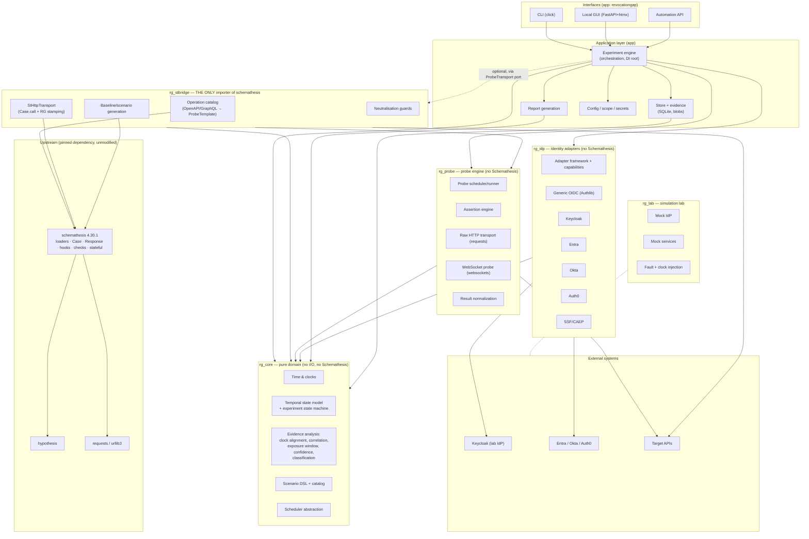

# Schemathesis Integration Specification (RG-P00-002)

**Selected upstream:** `schemathesis` **4.30.1** — released 2026-10-09 (GitHub release `v4.30.1`), PyPI wheel `schemathesis-4.30.1-py3-none-any.whl`, **MIT** (`License-Expression: MIT`; copyright Kiwi.com / Dmitry Dygalo & Schemathesis.io), `Requires-Python >=3.10`, classifiers 3.10–3.14 + PyPy. Source: <https://github.com/schemathesis/schemathesis>; docs: <https://schemathesis.readthedocs.io/en/stable/>.
**Verification method:** (E) executed against the installed 4.30.1 wheel — scripts and captured output in [`research-scripts/`](../../research-scripts/) (`ST_VERIFY_OUTPUT_4.30.1.txt`); (S) read from the installed 4.30.1 source; (D) documented in the official "Python API" reference (<https://schemathesis.readthedocs.io/en/stable/reference/python/>, fetched 2026-10-12). Nothing below is relied upon unless tagged E, S or D. Anything tagged **U** is an unverified assumption and must be re-verified by the named test before use.

## 1. Role of Schemathesis in RevocationGap

RevocationGap (RG) is a *temporal* authorization tester; Schemathesis (ST) is a *schema-driven, point-in-time* API tester. RG uses ST as the **API-description and HTTP-request layer**: discovering operations and security requirements from OpenAPI/GraphQL, constructing valid requests (including data generation for non-trivial bodies), executing them, and reproducing them (curl, cassettes). RG supplies everything about *time, identity state, revocation and interpretation*, which ST does not model. RG never forks, vendors or patches ST (system-prompt §1; ADR-0001).

## 2. Verified inventory of upstream capabilities

| # | Upstream capability | Verified interface (tag) | RG usage | Notes / hazards |
|---|---|---|---|---|
| U1 | Load OpenAPI 2.0/3.0/3.1/3.2 schema from URL, path, file, dict, ASGI/WSGI app | `schemathesis.openapi.from_url/from_path/from_file/from_dict/from_asgi/from_wsgi` (D, E: `from_dict`) | **Reuse** — operation discovery | `from_url(..., **kwargs)` passes kwargs to `requests.get` (headers, timeout, auth) — schema fetch itself needs credentials sometimes. `base_url` is **required** when the schema is not loaded from a server URL: `Case.call` raised `IncorrectUsage` until `schema.config.update(base_url=…)` or `call(base_url=…)` (E). |
| U2 | Load GraphQL schema (introspection URL, SDL file/string, dict) | `schemathesis.graphql.from_url/from_path/from_file/from_dict/...` (D, E: `from_file`) | **Reuse** — query/mutation operation catalog | Operation label `Query.me`; generated body `{"query": "{ me { id } }"}` posted by `Case.call` (E). **Subscriptions: U** (no WebSocket code path found: `grep -ri websocket` in 4.30.1 source hits only a Starlette adapter) → separate WebSocket adapter (§4, G1). |
| U3 | Operation model & security metadata | `BaseSchema.get_all_operations()`, `schema[path][method]`, `APIOperation.{label,path,method,security,responses,iter_parameters,definition,tags}`, `schema.include/exclude(...)` (D, E, S) | **Reuse** — enumerate candidate protected operations, read declared security schemes, filter by tag/path/method | `get_all_operations()` yields `Result[APIOperation, InvalidSchema]`; callers must unwrap (`.ok()`). |
| U4 | Construct a request with explicit values, no generation | `APIOperation.Case(method=, path_parameters=, headers=, cookies=, query=, body=, media_type=, ...)` (D, E) | **Reuse** — deterministic probe requests (`Case()` ≈ 11 µs, E) | Validates nothing by itself. |
| U5 | Generate valid/invalid requests from schema (Hypothesis) | `APIOperation.as_strategy(generation_mode=GenerationMode.POSITIVE)`, `BaseSchema.as_strategy`, `schema.given`, `get_strategies_from_examples` (D, E) | **Reuse (selective)** — derive a *valid baseline request* for operations without user-supplied parameters; use `examples`-first; vary non-semantic fields to defeat response caches (opt-in) | Random generated values often produce 4xx validation failures → **never** use unconstrained generated requests as the access oracle; probes use pinned, baseline-validated cases (§5.4). Negative generation modes are **not used** for temporal probes. |
| U6 | Execute a case over HTTP | `Case.call(base_url=, session=, headers=, params=, cookies=, **kwargs)` returns `schemathesis.Response` (D, E) | **Reuse** — the schema-described HTTP transport of RG probes | Accepts `timeout=`, `allow_redirects=` (E). Applies **no** registered auth provider and **no** reauth (E: registered provider ignored by plain `call`; `reauth_and_replay` appears only in `call_and_validate`, S). Each call without `session=` is a fresh connection with no cookies (E). Shared `requests.Session` shares cookies (E). Fixed `User-Agent: schemathesis/4.30.1` and `X-Schemathesis-TestCaseId` header are sent (E). |
| U7 | Response wrapper | `schemathesis.Response`: `status_code, headers (lowercase keys → list[str]), content, content_size, elapsed (seconds, duration only), request, verify, http_version, encoding, is_truncated, json(), text` (D, S, E) | **Reuse** as the raw container, immediately normalised into RG's `HttpExchange` (RG-P05-010) | **No send/receive timestamps** (E: no `time`/`date` attribute); `elapsed` is a duration. RG stamps `t_send_start/t_recv_end` itself around `Case.call` (§5.3). Server `Date` header is available in `headers['date']` (E) — 1 s resolution. |
| U8 | Custom response checks | `@schemathesis.check` functions `(ctx, response, case)`; class checks with `after_response/after_run`; `Case.validate_response(response, checks=[...])` (D, E) | **Reuse (limited)** — optional adoption of ST checks for *schema conformance* of probe responses and the `ignored_auth` pre-flight; RG's access assertions are **not** ST checks (they must run without Hypothesis, outside `Case.validate_response`, and produce typed `AssertionResult`s) | Registered checks are global (module-level registry) — RG registers none by default (isolation rule I-3). |
| U9 | Built-in `ignored_auth` check | `schemathesis.specs.openapi.checks.ignored_auth` (S; documented check name `ignored_auth`) — sends request without/with invalid auth and fails if 2xx | **Reuse as pre-flight negative control** (RG-P05-007): proves that "continued access" is not vacuous because the endpoint ignores auth | Point-in-time; uses `ctx.auth_enforced_operations` and re-sends via its own transport kwargs. RG additionally runs its **own** explicit no-credential / garbage-credential control probes because ST's check is only evaluated for declared security schemes and 2xx responses (S). |
| U10 | Hooks | `@schemathesis.hook` (global) and `schema.hook` (per schema): `before_call(ctx, case, kwargs)`, `after_call(ctx, case, response)`, `after_network_error`, `after_validate`, `map_*/filter_*/flatmap_*` (D, E: before/after_call fire) | **Limited reuse** — optional wire-adjacent timestamp capture; **not required** (RG brackets `Case.call` itself) | Global dispatcher = shared mutable state → forbidden for RG correctness (I-3); if used, only via `schema.hook` on a per-run cloned schema. |
| U11 | Auth providers | `@schemathesis.auth()` classes with `get/set`, `refresh_interval`, `cache_by_key`, `retry_on` (default `[401]`), `Case`-level `_auth` (D, S) | **Neutralise** (§6 N1–N3) — RG injects credentials explicitly per probe via `headers=`/`cookies=`/`session=` | Used inside ST's engine/hypothesis path: caches tokens for `refresh_interval` (default 300 s), re-fetches on 401, **would silently mask revocation**. Never register providers in an RG process; stbridge asserts `schemathesis.auths` registry empty (test ISO-5). |
| U12 | Stateful testing | `BaseSchema.as_state_machine()` → `APIStateMachine` with `setup/before_call/after_call/get_call_kwargs/validate_response/run` (D) | **Reuse for setup workflows** (RG-P07-005): discover create→read link chains to build the *authorised baseline workflow* (e.g. POST resource → GET resource) and to understand producer/consumer operations | Link-driven (OpenAPI links / inferred); Hypothesis-driven randomness; not suitable as the temporal probe loop. |
| U13 | Reproduction | `Case.as_curl_command(headers=, verify=, base_url=)` (D, E) | **Reuse** for reproduction steps, with caveat: ST **sanitises** sensitive header values (`Authorization: [Filtered]`, E). RG's reproduction renderer substitutes `${REDACTED:<handle>}` placeholders itself (RG-P08-011). | |
| U14 | Reports/recorders | HAR (`harfile`), VCR cassettes, JUnit, NDJSON, Allure, HTML via CLI handlers (S: `schemathesis/cli/commands/run/handlers`, `reporting/`) | **Not used directly** — these are CLI/engine-bound (undocumented in the Python API reference). RG exports HAR/JUnit/SARIF from its own evidence model (RG-P08-011); `harfile` may be used as a *library* for HAR writing (decision in RG-P08-011). | |
| U15 | Rate limiting | CLI/config `rate-limit` backed by `pyrate-limiter` (S) | **Not used** — RG needs per-identity/per-host limiter integrated with its probe scheduler (RG-P05-009). | |
| U16 | Config object | `schemathesis.Config` (= `SchemathesisConfig`), `schema.config.update(base_url=…)` (E; `Config` exported in `__all__` but **absent** from the documented API reference) | **Minimal**: only `schema.config.update(base_url=…)` and `from_*(config=Config(...))` construction with an RG-built config; no reliance on `schemathesis.toml` auto-discovery (`config=None` triggers auto-discovery, D) | RG must pass an explicit config to avoid picking up a stray `schemathesis.toml` in the working directory (test ISO-6). |
| U17 | Engine / events / phases | `schemathesis.engine.from_schema(schema).execute()` yields `EngineEvent`s (S) | **Not used** — not in the documented Python API; internal structure changes frequently. RG's own probe engine replaces the engine loop. | Adopting it would bind RG to unstable internals (RM-ST-3). |
| U18 | Deterministic generation | Config `generation.deterministic`, CLI `--seed` (D by third-party summary; S: `config/_generation.py` has `deterministic`) | **Reuse concept**: RG records the Hypothesis seed/derandomize settings used for any generated baseline request, so replays regenerate the same case. | Primary replay mechanism is a *serialised Case snapshot*, not regeneration (RG-P05-013). |
| U19 | Fuzz / coverage / targeted phases | CLI `st run`, `st fuzz`, coverage phase, `@schemathesis.metric` (D) | **Not used for temporal probing**. May be offered as optional pre-flight ("API sanity fuzz of baseline operations") in a later release (RG-P14-001). | Fuzzing a live authorization boundary risks side effects; default-off. |
| U20 | Python-app (ASGI/WSGI) transport | `from_asgi/from_wsgi`, `Case.call(app=...)` (D, S) | **Reuse in the lab**: RG's mock services (Starlette/Flask-style) can be exercised in-process without sockets for deterministic, virtual-time tests (RG-P09-001). | In-process transport has different timing semantics → lab-only, labelled in evidence (`transport.kind="inproc"`). |

## 3. Capabilities RevocationGap inherits (summary)

1. API description parsing and `$ref` resolution for OpenAPI 2.0–3.2 and GraphQL introspection/SDL (U1, U2).
2. Operation catalog with security-requirement metadata (U3) → automatic selection of *protected* operations as probe candidates.
3. Request construction/serialisation for all OpenAPI media types, multipart, parameter styles (U4, U6).
4. Valid-data generation for required parameters/bodies, with examples-first and custom formats (U5).
5. HTTP execution and response wrapping, TLS options, per-call kwargs (U6, U7).
6. Reproduction commands and (optionally) replay (U13).
7. Schema-conformance checks for responses and an authentication-enforcement pre-flight (U8, U9).
8. Link-based stateful workflow discovery for baseline set-up (U12).
9. In-process ASGI/WSGI execution for deterministic lab runs (U20).

## 4. Missing functionality requiring independent RG development

| ID | Gap (not provided by ST 4.30.1) | RG module | Strategy |
|---|---|---|---|
| G1 | Persistent connections: WebSocket, SSE long-lived streams beyond ST's bounded event-stream read (`DEFAULT_MAX_STREAM_EVENTS=20`, S), GraphQL subscriptions | `rg_probe.websocket` (RG-P05-011) | `websockets` library, asyncio-native, own adapter; no ST coupling. |
| G2 | Time as a first-class concept: send/receive instants, monotonic vs wall clocks, offset/uncertainty, scheduled probe cadence | `rg_core.time`, `rg_core.scheduler` | New modules (RG-P02-001, RG-P03-006). |
| G3 | Authorization *state* over time: identities, permissions, sessions, tokens, revocation events, expected enforcement | `rg_core` | New (RG-P02-*). |
| G4 | Multi-identity differential testing with per-identity credentials, cookie jars and connection pools | `rg_probe.credentials`, `rg_stbridge` session factory | New; ST gives only a single `session`/headers per call. |
| G5 | Credential lifecycle: OAuth/OIDC flows, refresh, introspection, revocation, logout, token analysis | `rg_idp` (Authlib) | New adapters. ST's auth providers are test-fixture helpers only. |
| G6 | Identity-provider administration (disable user, remove role, kill sessions, …) | `rg_idp` | New; out of ST's scope entirely. |
| G7 | CAEP/SSF SET receiving/transmitting | `rg_idp.ssf` | New. |
| G8 | Evidence model, clock alignment, exposure-window maths, classification, regression history, reports | `rg_core`, app | New. |
| G9 | Explicit success assertions on response *content* ("access actually granted", not HTTP 200) | `rg_probe.assertions` (RG-P05-006) | New; ST checks are schema-conformance oriented. |
| G10 | Scope enforcement/allowlist, safe-by-default mutating-operation policy | `rg_core.scope`, app | New (RG-P11-002). A probe plan is checked *before* any ST call is made. |
| G11 | Non-HTTP/IdP-side HTTP exchanges (token endpoint, introspection, Admin APIs) and schema-less targets | `rg_idp` (Authlib/requests) and `rg_probe.http_transport` | `requests`-based raw transport sharing the same urllib3/TLS semantics as ST (ADR-0004). |

## 5. Adapter boundary

### 5.1 Architecture diagram — reused upstream components vs original RevocationGap modules



Dependency rules (enforced by import-linter in CI, RG-P12-006): arrows point in the direction of allowed imports. `rg_core` imports nothing from the other packages; `rg_idp`, `rg_probe` import only `rg_core`; `rg_stbridge` imports `rg_core`, `rg_probe`, and `schemathesis`; the app imports all; **no package except `rg_stbridge` imports `schemathesis` or `hypothesis`**. `rg_lab` imports `rg_core` and may import `rg_idp`/`rg_probe` protocols but never `rg_stbridge`.

### 5.2 Ownership boundaries

| Concern | Owner | Upstream involvement |
|---|---|---|
| API schema parse, `$ref`, operation security | Schemathesis | Full |
| Mapping operation → RG `ProbeTemplate` (method, path template, parameters, security, expected content type) | `rg_stbridge.catalog` | Reads `APIOperation` |
| Choosing which operations to probe, scope checks | `rg_core`/app | None |
| Building the concrete request (`Case`) and serialising it | Schemathesis | `APIOperation.Case`, serializers |
| Credential values & which identity is sent | RG (`rg_probe.credentials`, `rg_idp`) | None (passed via `headers/cookies/session`) |
| Timing: when to send, instants, retries, pacing | RG | None (ST not asked to retry or pace) |
| Sending the bytes | Schemathesis (`requests`) via `Case.call` | Full |
| Interpreting the response (access established?) | RG assertion engine | None (reads `Response.status_code/headers/content`) |
| Schema-conformance of responses (optional) | Schemathesis checks, invoked by RG | `Case.validate_response` with explicit `checks=[...]` |
| Evidence, classification, reports | RG | None |

### 5.3 Proposed `rg_stbridge` public API (language-neutral contract; owned by RG-P05-005, RG-P05-012, RG-P07-005)

```python
# rg_stbridge/__init__.py  — everything else is private
from rg_core.model import ProbeTemplate, OperationRef, SecurityRequirement
from rg_probe.transport import HttpTransport, HttpExchange   # ports owned by rg_probe

def upstream_version() -> str: ...                    # returns schemathesis.__version__ ; compared with pinned range at import
def assert_supported_upstream() -> None: ...          # raises StBridgeIncompatible if version outside [4.30.1, 4.31) or isolation guards fail

class SchemaSource(TypedDict):                        # discriminated union
    kind: Literal["openapi_url","openapi_path","openapi_dict","graphql_url","graphql_sdl_path","graphql_dict"]
    location: str | dict
    base_url: str                                     # REQUIRED (ST needs it, verified E)
    fetch_headers: Mapping[str,str] | None            # credentials for fetching the schema document only

class OperationCatalog:
    @classmethod
    def load(cls, source: SchemaSource, *, timeout_s: float = 15.0) -> "OperationCatalog": ...
    def operations(self) -> Sequence[OperationRef]: ...                 # stable label e.g. "GET /docs/{id}", "Query.me"
    def describe(self, ref: OperationRef) -> OperationDescription: ... # security schemes, params, media types, declared responses
    def protected(self) -> Sequence[OperationRef]: ...                  # operations that declare a security requirement
    def derive_template(self, ref: OperationRef, *, values: Mapping[str, Any] | None = None,
                        generation: Literal["examples","generated","explicit"] = "examples",
                        seed: int | None = None) -> ProbeTemplate: ...  # produces pinned parameter values (no randomness remains)

class StHttpTransport(HttpTransport):                 # implements rg_probe port IF-PROBE-HTTP-TRANSPORT
    def __init__(self, catalog: OperationCatalog, *, clock: Clock, pool: SessionPool, limits: TransportLimits): ...
    async def send(self, request: PreparedProbeRequest, *, deadline: Deadline) -> HttpExchange: ...
    async def aclose(self) -> None: ...
```

Contract details (full spec in RG-P05-005):

* `StHttpTransport.send` runs `Case.call(...)` in a bounded `ThreadPoolExecutor` (ST/`requests` is synchronous; ADR-0004) with **explicit** `headers`, `cookies`, `session` (one `requests.Session` per *identity×host* in `SessionPool`), `timeout=(connect, read)`, `allow_redirects=False`, `verify=` from scope config.
* It stamps `t_send_start = (clock.wall_ns(), clock.mono_ns())` immediately before invoking `Case.call` and `t_recv_end` immediately after return (inside the worker thread), then builds `HttpExchange` (status, headers, body ≤ N bytes + hash, `elapsed`, server `Date`, TLS/connection reuse flags, correlation id). It never exposes `schemathesis.Response` to callers.
* Credentials are applied by `rg_probe.credentials` **after** the `Case` is built: headers/cookies merged into call kwargs; the `Case` object retains no credentials so that serialised snapshots are secret-free.

### 5.4 Probe validity: how ST's strengths are used without corrupting measurement

* A probe is `(OperationRef, pinned parameter values, identity, assertion set)`. Pinned values are chosen once per experiment by `derive_template` and **frozen**; a post-revocation probe must send byte-for-byte the same request as its baseline (same `Case` snapshot), otherwise a changed input could explain a changed outcome.
* Optional "cache-busting variation" (e.g., adding a nonce query parameter declared in the schema) is a *separate scenario dimension* with its own control, never silently applied.
* Baseline validation requires: authorised identity → assertion `access_established` true; unauthenticated/garbage-credential control → denied (RG-P05-007).

## 6. Hazards that would invalidate measurements — neutralisation table

| ID | Upstream behaviour | Risk to RG | Neutralisation (stbridge-enforced, tested) |
|---|---|---|---|
| N1 | Auth providers registered with `@schemathesis.auth()` cache tokens (`refresh_interval` default 300 s, S) | Stale token reuse; or hides credential change | `assert_supported_upstream()` fails if `schemathesis.auths` has any registered provider; RG never registers one; direct `Case.call` does not consult providers (E). |
| N2 | Reactive re-authentication on `retry_on` statuses (default `[401]`, S: `config/_auth.py`; `reauth_and_replay` in `call_and_validate`, S) | A revoked credential gets silently replaced and access "continues" — **false finding** | RG never calls `call_and_validate`; uses `call()` only (E shows no reauth/auth application in `call`). Test ISO-3 asserts exactly one wire request per probe attempt. |
| N3 | Engine "random credentials for alternative security schemes" bug fixed in 4.30.1 changelog (release notes) | Shows ST auth internals change between patch versions | Not used (engine unused); version-pin + compat suite. |
| N4 | `Case.call` re-sends / extra requests inside `ignored_auth` check (S) | Extra requests under test identity distort timing and may trigger lockouts | `ignored_auth` runs only in the **pre-flight** control stage, before the revocation event, and its requests are recorded as controls. |
| N5 | Hypothesis may re-run a test function (shrinking/replay) | Duplicate probe sends | RG does not run probes inside `@given`/`@schema.parametrize`; generation (if any) happens once in `derive_template`. |
| N6 | `User-Agent: schemathesis/4.30.1`, `X-Schemathesis-TestCaseId` header (E) | Fingerprinting; WAF/rate-limit rules keyed on UA; evidence ambiguity | Configurable header overrides applied via `headers=`; default: replace UA with `RevocationGap/<ver> (+authorized-test)`; keep a probe-correlation header `X-RG-Probe-Id` (opt-out for strict targets). Documented as operator-visible in scope config. |
| N7 | `Case.as_curl_command` sanitises `Authorization` as `[Filtered]` (E) | Reproduction lacks credential placeholder semantic | RG renders its own curl with `${RG_TOKEN_<identity>}` placeholders (RG-P08-011). |
| N8 | Redirect following (requests default) | A 302 to login followed to a 200 login page is a false "access" | `allow_redirects=False` always (E accepted kwarg); assertions see the 3xx. |
| N9 | Connection reuse (keep-alive, E) | Existing authenticated TCP/TLS connection may survive revocation, but also hides "new connection" behaviour | `SessionPool` policy per probe: `reuse` vs `fresh_connection` (per-probe flag), both recorded in `HttpExchange.connection_reused`. |
| N10 | Global hook/check registries (D, S) | Hidden global state across experiments in one process | RG registers none; guard asserts registries equal their import-time snapshot (test ISO-5). |
| N11 | `schemathesis.toml` auto-discovery when `config=None` (D) | Operator's stray config changes behaviour | Always pass explicit `Config`. Test ISO-6. |
| N12 | Response bodies read fully into memory (`Response.content`, S) | Memory with big bodies | `stream`/size-limits via transport kwargs where supported (**U**; verify `stream=True` semantics in RG-P05-005); otherwise cap at the target (Range header) or mark `is_truncated`. |

## 7. Compatibility risks

| ID | Risk | Likelihood | Impact | Mitigation |
|---|---|---|---|---|
| CR-1 | Very high release cadence: 4.21.10 (2026-06-19) → 4.30.1 (2026-10-09) ≈ 40 releases in 16 weeks (GitHub releases list) | High | Medium | Exact pin; weekly canary job; limit surface to documented API (RM-ST-3). |
| CR-2 | Breaking changes within 4.x in the *documented* API (e.g., `Case.call` signature) | Low–Medium | High | Isolation tests ISO-1…ISO-8 (§10) run on pinned and latest; `stbridge` thin and mockable. |
| CR-3 | Python-version window: ST supports 3.10–3.14; RG targets 3.11+ (ADR-0002) | Low | Low | RG range is a subset. |
| CR-4 | Dependency conflicts: ST pins `hypothesis<7`, `requests<3`, `jsonschema-rs<0.59`, `pytest<10`, `werkzeug<4`, `pyyaml<7`, `click<9`, `pyrate-limiter<5`, `anyio<5`, `harfile<1`, `hypothesis-graphql<1` (METADATA, S) — `pytest` and `werkzeug` are *runtime* deps of ST | Medium | Medium | `stbridge` distribution isolates the cone; app installs it; other distributions do not pull `pytest/hypothesis`. Resolve with a single lock file (uv) and CI `pip check`. Authlib (no conflicts found) / `requests` shared. |
| CR-5 | ST HTTP stack is `requests` (sync); RG async core | Certain | Medium | Thread-pool offload (bounded), measured overhead target in RG-P12-004. |
| CR-6 | Licence mixing: ST MIT; Hypothesis MPL-2.0 (transitive, not vendored); `jsonschema-rs` MIT; Authlib BSD-3 | Low | Low | Licence report in release (RG-P13-003); no vendoring. |
| CR-7 | Undocumented attributes (`Case._auth`, `Case.meta`, `schemathesis.Config`) change | Medium | Low | Not used (except `schema.config.update(base_url=…)`, covered by ISO-1). |
| CR-8 | `Case.call` kwargs forwarded to `requests` — semantics may shift | Low | Medium | ISO-2 asserts `timeout`, `allow_redirects`, `session`, `headers`, `cookies` all take effect. |
| CR-9 | Upstream removes `Case.call` without validation (unlikely; documented since v3) | Very low | High | Fallback: `RawHttpTransport` (RG-P05-004) executes the same `PreparedProbeRequest` without ST, degrading only schema-derived convenience. This fallback is a **required** part of the design so ST is an accelerator, not a single point of failure. |

## 8. Version-pinning strategy

* `pyproject` of `revocationgap-stbridge`: `schemathesis>=4.30.1,<4.31` (compatible window = one minor); the application lock file (`uv.lock`, hashes) pins the exact version `4.30.1`. Installing outside the window makes `assert_supported_upstream()` raise at startup with an actionable message (RG-P11-006 diagnostics also reports it).
* **Bump procedure:** (1) weekly scheduled CI job installs `schemathesis@latest` into a scratch env and runs the isolation + contract suites; (2) on green, a bot PR widens the window by one minor and updates the lock; (3) a human reviews the upstream CHANGELOG entries touching the documented API; (4) after merge, release notes state the new window. On red, the job opens an issue labelled `upstream-compat` with the failing ISO test.
* Major version (5.x): requires an ADR and a spec revision of RG-P05-005; no automatic widening.

## 9. Isolation and verification tests (specified; implemented later under RG-P12-006)

| ID | Test | Pass condition |
|---|---|---|
| ISO-1 | Load OpenAPI dict + GraphQL SDL; enumerate operations; `schema.config.update(base_url=…)` | Operation labels equal fixture expectations; `IncorrectUsage` when base_url missing is translated to `StBridgeConfigError`. |
| ISO-2 | `Case.call` honours `headers`, `cookies`, `session`, `timeout`, `allow_redirects=False` against a local server | Server sees exact header/cookie set; 302 not followed; timeout raises mapped error. |
| ISO-3 | One wire request per `send` (no reauth/replay) when server returns 401 and a provider is *not* registered; and with `retry_on` default | Server request counter increments by exactly 1. |
| ISO-4 | Credentials never serialised: `ProbeTemplate`/snapshot JSON contains no secret values | Secret canary string absent. |
| ISO-5 | Global registries (`schemathesis.auths`, hooks dispatcher, `CHECKS`) unchanged after full RG run | Snapshots equal. |
| ISO-6 | A stray `schemathesis.toml` in CWD does not alter behaviour | Same results with/without file. |
| ISO-7 | Import boundary: static analysis (import-linter) — no module outside `rg_stbridge` imports `schemathesis`/`hypothesis`/`pytest` | CI green. |
| ISO-8 | Upstream version window guard | `assert_supported_upstream()` raises for 4.29.x and 4.31.0 stubs. |
| ISO-9 | Timestamps: `t_send_start ≤ t_recv_end`, `t_recv_end − t_send_start ≥ Response.elapsed` | Holds over 1000 calls. |
| ISO-10 | Fallback parity: same `PreparedProbeRequest` through `RawHttpTransport` and `StHttpTransport` yields identical wire bytes (headers except UA, path, query, body) | Byte-equal on recorded server capture. |

The pre-specification evidence for ISO-1/2/3(partly)/9(partly) is the executed research scripts in `research-scripts/` (see `ST_VERIFY_OUTPUT_4.30.1.txt`).

## 10. Performance implications

* **Overhead measured (E, Python 3.11, in-process threaded stdlib HTTP server — server-side-bound, so treat as lower bound for ST itself):** `APIOperation.Case(...)` construction ≈ 11 µs; 400 `Case.call` requests over 8 threads with per-thread `requests.Session` completed at 122–177 req/s (variation across runs). Conclusion: ST-side CPU cost per probe is dominated by `requests`, not Schemathesis; the benchmark plan (RG-P12-004) re-measures with an out-of-process server.
* Import cost: importing `schemathesis` pulls Hypothesis, pytest, werkzeug, jsonschema-rs, rich, click — lazy-import in `rg_stbridge` only when an ST-backed probe is configured, keeping `rg --help` and non-ST workflows fast (RG-P12-004 startup target).
* Memory: `OperationCatalog` holds the parsed schema (large OpenAPI documents of several MB ⇒ tens of MB). One catalog per target, shared across threads (read-only after `load`); thread-safety of concurrent `Case.call` on one schema object across threads is **exercised in E (8 threads sharing one `APIOperation`)**, but upstream does not document it as thread-safe → RG treats `OperationCatalog` as immutable and creates `Case` objects per call; ISO-11 (stress) is added to RG-P12-006.
* Scheduling jitter: thread dispatch adds latency; the probe scheduler budget is in RG-P05-008/P12-004 (target: p95 send-time error ≤ 25 ms on a 4-core reference VM with ≤ 50 concurrent probes — a proposal to validate).

## 11. Upstream upgrade strategy and maintenance implications

* RG owns ≈ 1.5–2 kLOC of bridge code (estimate for planning) and one weekly CI job. No fork ⇒ no merge burden; failure mode is "pin held back", which is acceptable because RG's value is not in ST's newest generation features.
* Upstream-contribution policy: if a missing capability is generic (e.g., per-call timestamps on `Response`), file an upstream issue/PR rather than patch locally. **No upstream modification is required by this specification** (no justification record needed under system-prompt §1).
* Exit strategy: because `rg_probe` defines the `HttpTransport` port and `RawHttpTransport` implements it, ST can be removed without touching core/idp/report modules (CR-9).

## 12. Complementary dependencies (summary; evidence in provider research docs)

| Dependency | Role | Status of evaluation |
|---|---|---|
| **Authlib** | Preferred OAuth 2.0/OIDC client library (requests-based `OAuth2Session`, RFC 7009 revoke, RFC 7662 introspect, discovery, JOSE). Installed version in the verification environment: Authlib 1.8.0 (alongside ST 4.30.1, no resolver conflict — E: `pip install schemathesis authlib`). | Detailed capability/limits research: `providers/AUTHLIB-AND-LIBS.md` (agent research, integrated by RG-P00-005/006). |
| **Keycloak** | First real IdP for the integration lab (docker). | `providers/KEYCLOAK.md`. |
| `requests`, `urllib3` | Single HTTP stack shared with ST (ADR-0004). | Decided. |
| `websockets` | WebSocket adapter. | Evaluated in RG-P05-011. |
| `pydantic` v2 | Typed contracts and JSON Schema export. | ADR-0007. |
| `cryptography` | Evidence encryption. | RG-P11-003. |
| `httpx` | **Not** the primary stack; ST can wrap httpx responses but RG avoids a second client stack. | ADR-0004. |

## 13. Verification log (research scripts, executed 2026-10-12 against 4.30.1)

| Script | Demonstrated |
|---|---|
| `st_verify_1_basics.py` | `from_dict`; `get_all_operations`; deterministic `Case`; `as_curl_command` filters `Authorization`; `Case.call(headers=…)`; before/after hooks fire; `Response` has no timestamp attribute but has `Date` header; custom `@check` works with `validate_response(checks=[…])`; registered `@schemathesis.auth()` provider is **not** applied by `Case.call`. |
| `st_verify_2_concurrency.py` | 8 threads × per-thread `Session` × `Case.call`; `Case()` ≈ 11 µs; `timeout=`/`allow_redirects=False` accepted; `X-Schemathesis-TestCaseId` sent. |
| `st_verify_3_graphql_cookies.py` | GraphQL SDL operation listing + generated query executed with `Case.call`; cookie persistence only with shared `Session`; keep-alive; UA `schemathesis/4.30.1`. |

Open **U** items to close in specification (owner): `stream=True`/body-size limits through `Case.call` kwargs (RG-P05-005); GraphQL subscription non-support confirmation via upstream issue search (RG-P05-012); thread-safety stress (RG-P12-006).
