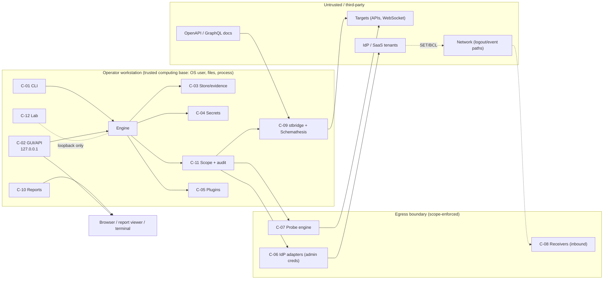

# RevocationGap — Threat Model (RG-P01-003)

**Status:** DRAFT · **Builds on:** [`../00-PROJECT-CHARTER.md`](../00-PROJECT-CHARTER.md) · **Feeds:** RG-P01-004 (PRD: lift each *SHALL* statement into an FR/NFR), RG-P07 (scenario catalogs), RG-P08 (validity/classification), RG-P11 (security engineering).

**Citation keys:** `[TF]` (risks `R-xxx`), `[CA]`, `[STD]` (`STD-xxx`, `SV-xxx`, §3 taxonomy), `[ST]` (`U#` inventory, `N#` neutralisations, `G#`, `CR-#`, `ISO-#`), `[KC]`, `[EN]`, `[OK]`, `[A0]`, `[AL]`, `[RR]`, `[MP]` (master prompt). Evidence tags follow the research docs: **V** verified, **I** inferred, **U** unverified. Claims about third-party behaviour that are not established in the research are marked **U** and carry a verification owner. Charter IDs (GOAL/NG/SC/D/RU) are in [`../00-PROJECT-CHARTER.md`](../00-PROJECT-CHARTER.md); workflow/scope IDs (WF, SCR) in [`USER-WORKFLOWS.md`](USER-WORKFLOWS.md).

**Document structure.** **Part A** models the *targets* RevocationGap tests: actors, assets, boundaries, attack objectives AO-01…AO-10, the 15 mandatory scenarios SCN-01…SCN-15 and the test-validity requirements TV-01…TV-25 that make a finding trustworthy. **Part B** models *RevocationGap itself* (STRIDE) with threats TM-01…TM-34, each with a requirement-ready statement.

---

# PART A — Target-side security model (what RevocationGap tests)

## A.1 Threat actors

| ID | Actor | Capability / starting position | Relevant mechanisms |
|---|---|---|---|
| TA-01 | **Terminated insider with retained credentials** | Was authorised; holds copies of access/refresh tokens, a browser session cookie, perhaps an open WebSocket and knows the password; employer disables the account and ends sessions | AT survival until `exp` (SV-012), RT survival (SV-019/024), app-session survival (SV-032/033), reconnect (SV-055) |
| TA-02 | **Stolen-token holder** | External party with a copied token (log leak, malware, proxy) but no password; victim or admin revokes after discovery | Revocation reach (AT vs RT vs session), cache windows, bound-token enforcement (SV-035) |
| TA-03 | **Demoted user** | Still an authorised user; a role/group was removed; keeps using privileged operations | Stale role claims in unexpired JWTs, cached decisions, claims refreshed only at next refresh [KC §1.2, §5 item 7]; group claims stale [OK §(e) item 9; EN §5 item 5] |
| TA-04 | **Compromised service account / workload identity** | Holds client credentials/session-less tokens; privileges or credential are removed | Session-less tokens ignore session logout [KC §1.2]; service-principal CAE is Graph-only [EN §1.3] |
| TA-05 | **Malicious tenant administrator (federated / multi-tenant)** | Administers one tenant/IdP of a federation; can re-enable, restore, regroup, or suppress/delay revocation signals; guest/B2B users sit under it | Reactivation inconsistency [KC §1.2 (re-enable revives tokens)]; guests not covered by CAE and RTs not revoked in the resource tenant [EN §1.3, §5 item 7]; federation chains may silently re-issue tokens [A0 §(e) item 12] |
| TA-06 | **Network attacker on logout/event delivery paths** | Can drop, delay, duplicate, reorder or spoof front-/back-channel logout calls and SET deliveries between IdP and receiver; cannot break TLS | Events delayed/duplicated/out of order [OK §(c), §0 item 7; STD SV-037]; back-channel logout acceptance rules (SV-025/026); RFC 8417 timing caveat [OK §(c)] |

## A.2 Assets

| ID | Asset | Why it matters to this model |
|---|---|---|
| AS-01 | Protected resources and operations (API operations, documents, admin functions) | The thing an attacker retains access to |
| AS-02 | Credentials: access/refresh/offline tokens, ID tokens, session cookies, client secrets, WebSocket handshake tickets | What the attacker holds |
| AS-03 | Authorization state at the IdP: enabled flag, role/group mappings, session records, not-before, token-revocation lists | The *source of truth* an event changes |
| AS-04 | Authorization state at enforcement points: introspection caches, decision caches, replicas, gateway tables, session stores, connection tables | Where stale state lives |
| AS-05 | Revocation/event channels: admin APIs, revocation/logout endpoints, SET/CAEP streams, back-channel logout | How state change travels |
| AS-06 | Revocation evidence: provider logs, acknowledgments, timestamps | What proves (or fails to prove) that the change happened and when |

## A.3 Trust boundaries

| ID | Boundary | Observation for testing |
|---|---|---|
| TB-A1 | IdP ↔ resource server (validation channel: local JWT, introspection, userinfo) | Validation mode decides the expected row of [STD §3] |
| TB-A2 | Client ↔ gateway ↔ backend | Gateway and backend can disagree (SCN-07); direct-to-backend access is only testable if declared in scope |
| TB-A3 | Resource server ↔ cache/session store/replica | Staleness windows; non-monotonic enforcement [CA §4.4] |
| TB-A4 | IdP ↔ receiver (SET push/poll, back-channel logout) | Delivery ≠ enforcement (SV-037) |
| TB-A5 | Admin plane ↔ data plane | Admin acknowledgment ≠ data-plane denial (SV-005) |
| TB-A6 | Tenant ↔ tenant (federation, guests) | Revocation may not cross it [EN §5 item 7] |
| TB-A7 | Established connection ↔ connection setup | A live socket is authenticated once (SV-055; RFC 6455 has no re-auth [STD §3]) |

## A.4 Attacker assumptions

AA-01 The attacker knows API endpoints and can issue requests at any rate the target permits. AA-02 The attacker retains every credential copy that existed at revocation time and cannot forge signatures or keys. AA-03 The attacker cannot change IdP state except TA-05. AA-04 TA-06 cannot defeat TLS but controls timing/ordering/duplication of deliveries it can reach. AA-05 The target's validation mode is unknown to the attacker and to the tester until probed (RG determines or is told it: charter §10 "Validation mode"). AA-06 Natural token expiry eventually ends all unrefreshed access tokens; the question is *how long before that*.

## A.5 Attack objectives

| ID | Attack objective | Actors | Attacker "success" | Impact if achievable | Scenarios |
|---|---|---|---|---|---|
| AO-01 | Maintain access after account disablement/deletion | TA-01, TA-02 | Operations succeed after the disable acknowledgment beyond the expectation | Offboarded user keeps data access | SCN-02, SCN-10 |
| AO-02 | Maintain access after explicit logout/session termination | TA-01, TA-02 | Replayed session/token still accepted after logout/session kill | Session hijack persists | SCN-03, SCN-08 |
| AO-03 | Retain or escalate privilege through stale role/group claims or cached decisions | TA-03 | Privileged operation still succeeds after role removal | Privilege retention/escalation | SCN-01, SCN-05, SCN-06 |
| AO-04 | Persist via refresh token (mint new access after revocation) | TA-01, TA-02 | Refresh yields new access token after the event that should invalidate it, or after rotation replay | Indefinite persistence | SCN-04 |
| AO-05 | Persist via long-lived connection or reconnection | TA-01 | Open socket keeps serving, or reconnect succeeds, after revocation | Persistence past token lifetime | SCN-08 |
| AO-06 | Exploit cross-service enforcement gaps | TA-01, TA-03, TA-05 | Service B (or backend) accepts while service A (or gateway) denies | Lateral access through the weakest enforcer | SCN-05, SCN-07, SCN-09, SCN-11, SCN-15 |
| AO-07 | Exploit event delay, ordering, duplication or non-enforcement | TA-06, TA-05 | Delivered-but-unenforced SET; late/out-of-order event leaves access active or lets a stale restore override a revoke | Silent bypass of CAE/CAEP | SCN-12, SCN-13 |
| AO-08 | Regain access through reactivation/restoration inconsistencies | TA-05, TA-01 | Pre-disable credentials work again after re-enable; services disagree on restored state | Resurrected access | SCN-14 |
| AO-09 | Retain workload/service-account privileges after removal | TA-04 | Client-credential tokens or secrets keep working after account/role/client removal | Persistent machine access | SCN-10 |
| AO-10 | Exploit distributed disagreement and non-monotonic enforcement | any | Access flaps (denied then allowed) or persists on some replicas/regions | Intermittent/regional bypass | SCN-06, SCN-15 |

Every SCN maps to at least one AO and every AO to at least one SCN (checked in §A.6).

## A.6 Mandatory scenarios (identity and one-line expectations)

Order and wording follow the master list [MP Phase 7]. Full specifications (preconditions, procedure, expected evidence, false-positive risks, independent validation) are written in RG-P07-002/-003/-004. "Normal" means behaviour consistent with the declared policy profile and validation mode; "Vulnerable" means access beyond it that survives the validity rules of §A.7.

| ID | Scenario | AO | Normal | Vulnerable |
|---|---|---|---|---|
| SCN-01 | Access survives revoked role | AO-03 | Operations requiring the role are denied by the resource server's own decision within the expectation: immediately for introspection/session lookup (introspection shows the *current* roles [KC §1.2]); at next token issuance for local-JWT servers (roles are a snapshot, RFC 9068 §2.2.3.1 [STD §3]) | The role-gated operation still succeeds beyond the window (past `exp`, past the cache TTL, or after a refresh that already carries the reduced roles) |
| SCN-02 | Access survives account disablement | AO-01 | Introspection `active:false`, userinfo 401, refresh `invalid_grant` after disable [KC §1.2]; local-JWT servers accept until `exp` (SV-012, `EXPECTED`) | Introspection still `active:true` beyond the window (SV-015); refresh succeeds; access beyond `exp` (SV-010); app session survives under an ASVS profile (SV-033) |
| SCN-03 | Existing session survives logout | AO-02 | Server-side session invalid after logout; back-channel logout clears the identified session (SV-025, STD-017 §2.7); API tokens may legitimately survive RP logout (SV-030) | Replayed session cookie/token still accepted after explicit logout under an ASVS profile (SV-032), or RP returns 200 to a valid logout token yet keeps the session (SV-025) |
| SCN-04 | Refresh token remains usable after an action expected to invalidate it | AO-04 | Revoked RT → HTTP 400 `invalid_grant` (SV-019); after disable/logout the AS refuses refresh [KC §1.2]; rotation replay rejected and family revoked (SV-022) | Refresh returns a new access token after RT revocation (SV-019), or an already-rotated RT is accepted by a public client (SV-022), or the newest RT survives a reuse event under an ASVS profile (SV-057) |
| SCN-05 | Privilege changes do not propagate to dependent services | AO-03, AO-06 | Downstream service B reflects the change per its own validation mode and documented window | B continues to authorise the old privilege beyond its window while A/IdP already reflect the change |
| SCN-06 | Cached authorization remains active | AO-03, AO-10 | Acceptance ends at a bounded cache TTL (step at constant offset after the event, SV-016) never beyond `exp` | Acceptance continues beyond any configured TTL or beyond `exp` (SV-010/016), or no invalidation ever occurs |
| SCN-07 | API gateway and backend authorization disagree | AO-06 | Gateway and backend converge on denial within their windows | One of them keeps accepting a request the other denies (e.g. backend accepts when reached directly, or gateway-validated token accepted by backend after revocation) |
| SCN-08 | Session can reconnect after revocation | AO-02, AO-05 | New handshake/login with the revoked credential is rejected (no 101; "Account disabled"-class denial [KC §2.2]) (SV-055 a) | Handshake returns 101 (or a session resumes) with a revoked credential; open-connection survival alone is `NEEDS_VERIFICATION`, not `VULN` (SV-055 b) |
| SCN-09 | Token remains usable in a service whose policy requires earlier rejection | AO-06 | Service rejects within its *declared* policy (e.g. per-call introspection ⇒ `active:false` ⇒ reject) | Service accepts beyond its declared/contractual window; requires a declared expectation (`vendor-doc`/contract profile) — SV-012 permits `VULN` only when a promise exists |
| SCN-10 | Service-account privileges remain after removal | AO-01, AO-09 | Session-less client-credentials AT flips inactive when the service-account user/client is disabled or realm not-before advances; session logout does not affect it [KC §1.2]; new client-credentials grants are refused (I) | Tokens or secrets keep working after service-account/client disable or role removal beyond the window; new client-credentials grants still succeed |
| SCN-11 | Revocation behaviour differs across applications | AO-06 | Applications with the same declared policy converge; differences are explained by declared validation modes | Undeclared divergence: at least one application lags beyond the policy or never enforces (differential finding, classified per application) |
| SCN-12 | CAEP notifications delivered but not enforced as expected | AO-07 | Receiver enforces within its documented behaviour after SET delivery | SET acknowledged (delivery proven) but access continues beyond the receiver's declared policy (SV-037); undeclared policy ⇒ `NEEDS_VERIFICATION` |
| SCN-13 | Revocation events delayed, duplicated or out of order | AO-07 | Receiver is idempotent and order-tolerant; at-least-once and out-of-order delivery do not leave access active or revive revoked access (RFC 8417 timing caveat, [OK §(c)]; STD-019 is **U**) | A late, duplicate or reordered event leaves access active, or a stale restore overrides a later revoke |
| SCN-14 | Permission reactivation creates inconsistent authorization | AO-08 | Reactivation requires fresh authentication; pre-disable credentials stay invalid, and all services agree on the state (policy-dependent) | Pre-disable tokens/sessions resume working after re-enable (observed in Keycloak [KC §1.2, RF-3]) or services disagree on whether they work (profile decides `RISKY_CONFIG` vs `VULN`) |
| SCN-15 | Distributed components disagree about authorization state | AO-06, AO-10 | Replicas/caches/regions converge within the documented window; enforcement is monotonic | Persistent disagreement across nodes/regions, or non-monotonic enforcement (denied then allowed, [CA §4.4]); multi-node Keycloak behaviour is **U** (RQ-6) and needs a ≥ 2-node lab profile |

## A.7 Test-validity requirements (TV)

A finding is trustworthy only if every applicable TV rule holds. The rules **reuse** the SV rules of [STD §4] (cited, not redefined) and the neutralisations of [ST §6]; the owning later element specifies the mechanism. A violated rule downgrades the outcome per its SV (usually `INCONCLUSIVE`).

| ID | Requirement (The system SHALL…) | Source | Owner |
|---|---|---|---|
| TV-01 | …run a **positive control** (authorised credential accepted by the same frozen request) before any revocation event, and classify `INCONCLUSIVE` if it fails | SV-001 | RG-P05-007 |
| TV-02 | …run a **negative control** (garbage/foreign credential of the same shape, and no credential) on the same endpoint and classify `INCONCLUSIVE` if it is accepted or if all tokens yield the same response | SV-001; [ST §5.4]; SC-04 | RG-P05-007 |
| TV-03 | …send post-event probes **identical** to the baseline in method, URL, headers, body, scopes, client and any proof-of-possession material, differing only in credential/session state; DPoP/mTLS proofs are regenerated per probe | SV-002; [ST §5.4]; ISO-4 | RG-P05-001/-003 |
| TV-04 | …confirm state with an **independent oracle** (introspection, resource probe, refresh attempt, `prompt=none`) and never treat a revocation/logout endpoint's success code as proof; 503 at revocation ⇒ step failed | SV-005, SV-006, SV-007, SV-045 | RG-P06-009, RG-P08-006 |
| TV-05 | …decide *confirmed access* only from explicit, target-appropriate assertions (status + header/body markers + semantic content); an HTTP 200, or a 3xx followed to a login page, SHALL NOT alone confirm access; redirects SHALL NOT be followed | [MP C]; SV-009; [ST N8] | RG-P05-006 |
| TV-06 | …anchor time zero at the acknowledgment on the best-aligned clock and carry the anchor uncertainty (request-sent → ack-received; manual M1 → M2) into the interval | SV-004; WF-04 | RG-P06-009, RG-P08-002 |
| TV-07 | …require multiple samples and a **confirmation tail** of N consecutive confirmed denials before declaring a first denial; report flapping instead of finalising | SV-004, SV-047; [TF R-004] | RG-P05-008, RG-P08-004 |
| TV-08 | …stamp each probe with monotonic and wall-clock send/receive times, compute intervals on the monotonic clock, align wall clocks by the SV-048 procedure and emit no timing verdict from differences < ~2 s or from a single sample | SV-047, SV-048; [TF R-007]; [ST §5.3] | RG-P02-001, RG-P08-002 |
| TV-09 | …separate natural expiry from revocation using the credential's known `exp`/`iat` (where decodable) and a **sibling control** from the same grant | SV-010–012; [CA §4.4] | RG-P05-007, RG-P08-006 |
| TV-10 | …discover capabilities rather than assume them; an absent capability (`unsupported_token_type`, no `revocation_endpoint`) yields `NOT_APPLICABLE`/`EXPECTED`, never `VULN` | SV-018, SV-044, SV-054; [EN §1.7] | RG-P04-001 |
| TV-11 | …record the policy profile in every classification and print the skew bands (`skew_tolerance_s`, `skew_ambiguous_s`) used | SV-046, SV-047 | RG-P02-009 |
| TV-12 | …isolate probe side effects: one disposable token family/session per probe slot; refresh probes never share a family with other observations | [KC §5 item 4]; [A0 §(e) item 4]; [OK §(e) item 3]; SV-023 | RG-P05-003 |
| TV-13 | …treat 429/`Retry-After` and 5xx windows as indeterminate (pause, mark the window), never as denial | SV-043; [TF R-005] | RG-P05-009 |
| TV-14 | …discard responses served from a cache (positive `Age`) as observations and mark the sample indeterminate | SV-048 | RG-P05-010 |
| TV-15 | …enforce a ≥ 1 s settle between minting probe credentials and the revocation event where the provider evaluates `iat < notBefore` at second resolution | [KC §5 item 1]; [TF R-008] | RG-P04-007 |
| TV-16 | …neutralise every upstream behaviour that can alter a probe: no reactive re-authentication, no token caching, no registered auth providers/global hooks, exactly one wire request per probe attempt, no redirect following | [ST N1, N2, N4, N5, N8, N10, N11]; RM-ST-5; ISO-3/5/6 | RG-P05-005 |
| TV-17 | …distinguish credential rejection from probe malformation or client-authentication failure (400 `invalid_request`, 401 `invalid_client`, wrong presentation method) and mark those `INCONCLUSIVE` | SV-003, SV-008, SV-009, SV-049 | RG-P05-006, RG-P04-002 |
| TV-18 | …use fresh synthetic identities per scenario and never re-enable an identity as cleanup between experiments | [KC §5 item 3]; [EN §5 item 4] | RG-P06-010 |
| TV-19 | …label every report statement as observed fact, calculated value, assumption or hypothesis, and list each assumption with its falsification test | [MP D]; SC-12 | RG-P08-011 |
| TV-20 | …record in the run manifest provider/library versions, enabled provider features and settings that change outcomes (e.g. Auth0 "Refresh Token Revocation Deletes Grant", Keycloak event types), seeds, clock kind and schedule | [KC §5 item 14]; [A0 §(e) item 5]; [TF R-009] | RG-P08-001 |
| TV-21 | …repeat trials against non-deterministic SaaS targets within the scope limits and report bounded statistical claims, not single-run exactness | [TF §1 last row]; [CA §4.4] | RG-P08-005 |
| TV-22 | …attribute a mechanism (JWT `exp`, introspection, session lookup, cache TTL, claims challenge, refresh failure) only when supporting signals exist; otherwise leave the attribution `unknown` | [CA §4.1 CA-D2]; SV-009, SV-016 | RG-P08-006 |
| TV-23 | …before emitting `VULN`, require (a) valid controls, (b) confirmation by a second independent oracle or repetition, and (c) the profile rule that makes the behaviour a violation | SV-010, SV-015, SV-019; SV-046 | RG-P08-006 |
| TV-24 | …use provider logs only as lagging secondary evidence, never as the time-of-event source | [EN §5 item 9]; [OK §(e) item 7] | RG-P08-002 |
| TV-25 | …establish the CAEP stream baseline (stream `enabled`, Verification event delivered, subject subscribed) before measuring delivery/enforcement; absence of events with a paused/disabled stream is expected | SV-038; [KC §5 item 12] | RG-P04-011 |

Coverage check: TV-01/02/05 → GOAL-04; TV-06/07/08 → GOAL-01 (D-5); TV-10/11/22 → D-3; TV-16 → RM-ST-5; TV-19 → GOAL-05.

---

# PART B — Tool-side threat model (STRIDE over RevocationGap)

## B.1 Method, scale and components

STRIDE (Spoofing, Tampering, Repudiation, Information disclosure, Denial of service, Elevation of privilege) applied per component. Severity: **C** critical (can harm third parties or production, or disclose administrative credentials, in the default configuration), **H** high, **M** medium, **L** low — same scale as the risk register [TF §3]. Exposure facts come from [ST] and [TF]; statements marked **U** need verification by the named element.

| ID | Component | Description | Holds / touches |
|---|---|---|---|
| C-01 | CLI | `click` + `rich` front end [TF §2] | Operator input, target-derived strings on screen |
| C-02 | Local GUI web server + automation API | FastAPI + Jinja2 + htmx + SSE on loopback [TF §2] | Session state, arming controls, evidence views |
| C-03 | Store and evidence | SQLite (WAL) + content-addressed blobs [TF §2] | Raw exchanges, tokens (until redacted), run history |
| C-04 | Secrets handling | Credential handles, redaction, optional AES-256-GCM [AL §0] | Test-identity credentials, admin credentials |
| C-05 | Plugin loader | Adapter/transport/report plugins | Code execution in the RG process |
| C-06 | IdP adapters | Keycloak/Entra/Okta/Auth0/generic OIDC | **Administrative credentials** that can disable users, revoke sessions |
| C-07 | Probe engine | Scheduler, transports (`requests`, `websockets`), assertions | Outbound traffic to targets, test-identity credentials |
| C-08 | Event receivers | CAEP/SET receiver (poll client; optional push endpoint) and back-channel-logout receiver | Inbound network exposure |
| C-09 | Schemathesis bridge | `rg_stbridge`; pinned upstream 4.30.1 and its dependency cone (hypothesis, pytest, werkzeug, …) [ST CR-4] | Untrusted OpenAPI/GraphQL documents; third-party code |
| C-10 | Report generator | JSON/Markdown/HTML/HAR/JUnit/SARIF writers | Target-derived content rendered in viewers |
| C-11 | Scope enforcer and audit log | Scope validation, arming, audit trail | The authorization gate |
| C-12 | Lab (mock IdP, mock services, Keycloak) | Test doubles with weak credentials | Local listeners |

Boundary notes: the operator workstation and OS user are *trusted* (an attacker with local administrator rights is out of scope, RU-12); everything arriving from targets, IdPs, schema documents, event channels, plugins and dependencies is *untrusted input* until validated.

## B.2 STRIDE coverage matrix

| Component | S | T | R | I | D | E |
|---|---|---|---|---|---|---|
| C-01 CLI | — | TM-11 | — | TM-07 | TM-10 | TM-11 |
| C-02 GUI/API | TM-17 | TM-16 | TM-27 | TM-07, TM-17 | TM-34 | TM-16, TM-18 |
| C-03 Store/evidence | — | TM-26, TM-15 | TM-26 | TM-08 | TM-34 | TM-15 |
| C-04 Secrets | — | — | — | TM-07, TM-09 | — | TM-09 |
| C-05 Plugin loader | TM-22 | TM-22 | — | TM-22 | — | TM-22 |
| C-06 IdP adapters | TM-33 | TM-05 | TM-27 | TM-09 | TM-29 | TM-05, TM-09 |
| C-07 Probe engine | TM-13, TM-33 | TM-14 | — | TM-07 | TM-10, TM-29 | TM-01–TM-03 |
| C-08 Receivers | TM-19 | TM-20 | — | TM-21 | TM-20, TM-21, TM-34 | TM-21 |
| C-09 stbridge/ST | — | TM-25 | — | — | TM-04 | TM-04, TM-23, TM-24 |
| C-10 Reports | — | TM-12 | TM-26 | TM-07 | — | TM-12 |
| C-11 Scope/audit | TM-31 | TM-06 | TM-27 | — | — | TM-01–TM-06, TM-31 |
| C-12 Lab | — | — | — | TM-32 | — | TM-32 |
| (cross-cutting) | TM-28 time source (T/R), TM-30 side effects (T), TM-31 abuse (E/R) | | | | | |

## B.3 Threat register

Each row: threat → **requirement-ready statement** → later element that specifies it. "SHALL" statements are written so the PRD author can lift them verbatim into FR/NFR.

### B.3.1 Scope, egress and hostile schema (C-07, C-09, C-11)

| ID | Sev | Threat (STRIDE) | Requirement | Later element |
|---|---|---|---|---|
| TM-01 | H | **Scope bypass via redirects (E):** a 3xx from an in-scope host sends the probe to an out-of-scope host; `requests` follows redirects by default [ST N8] | The system SHALL send every probe and adapter HTTP call with redirect-following disabled (`allow_redirects=False` or equivalent) and SHALL record any `Location` as data; following a redirect SHALL be a separate probe that is itself checked against the scope before it is sent. Test: out-of-scope canary listener receives 0 requests (SC-06) | RG-P05-004, RG-P11-002 |
| TM-02 | H | **Scope bypass via schema-provided server URLs (E):** OpenAPI `servers`/GraphQL endpoint entries or a schema fetched from a URL steer requests to hosts the operator did not scope. `Case.call` requires an explicit `base_url` when the schema is not loaded from a server URL (verified, [ST U1]); whether Schemathesis derives an effective base URL from `servers` or the schema URL is **U** (verify in RG-P05-005) | The system SHALL take the effective base URL for every request exclusively from operator scope configuration after scope validation; schema `servers` entries SHALL be informational only and a mismatch with scope SHALL be reported as a warning; every constructed request URL SHALL be scope-checked immediately before sending | RG-P05-005, RG-P11-002 |
| TM-03 | H | **Resolved-address pivots / DNS rebinding (E):** an allow-listed hostname resolves (or later re-resolves) to loopback, link-local, cloud-metadata (e.g. 169.254.169.254) or internal addresses | The system SHALL resolve each scoped hostname once per experiment, SHALL pin connections to the validated address set, SHALL deny loopback/private/link-local/metadata addresses unless the scope entry lists them explicitly, and SHALL record the resolved addresses in evidence | RG-P11-002, RG-P05-004 |
| TM-04 | H | **Malicious OpenAPI/GraphQL document (D, E):** Schemathesis loads untrusted schemas and resolves `$ref`; `from_url(**kwargs)` passes straight to `requests.get` (verified, [ST U1]), so fetching and following refs would happen **outside** RG's scope-enforcing transport (I). Remote-`$ref` fetch behaviour, YAML alias/depth limits and resource use of `from_dict` are **U** — not covered in [ST] (§9 ISO tests do not include them) | The system SHALL fetch schema documents only through the scope-enforcing transport (never via Schemathesis `from_url`), SHALL enforce a maximum document size and nesting depth before parsing, SHALL parse YAML with a safe loader and reject alias expansion beyond a configured limit, SHALL reject documents containing `$ref` URIs other than same-document fragments (local-file refs only within an operator-declared directory), and SHALL pass the checked document to Schemathesis as an in-memory dictionary (`from_dict`). Catalog loading SHALL run under a wall-clock timeout on all platforms and a memory cap where the platform supports one (parity decision: RG-P03-011). RG-P05-005 SHALL add verifying tests for remote `$ref`, billion-laughs and deep-nesting inputs (extends ISO-1) | RG-P05-005, RG-P12-006 |
| TM-05 | C | **Destructive admin action on the wrong tenant/identity (T, E):** disable/delete/revoke aimed at a non-test user, the wrong realm/tenant, or production | The system SHALL execute an administrative action only if (a) the experiment is `ARMED` with the scope digest pinned, (b) the action, tenant and identity match a scope entry exactly (no wildcards), (c) the identity is declared `synthetic`, and (d) a read-back of the tenant identifier from the IdP at preflight equals the scoped tenant. Arming SHALL require the operator to type the tenant identifier. The adapter SHALL address users by declared immutable id and SHALL NOT enumerate other users. Any failure SHALL abort before the network call (SC-09) | RG-P11-002, RG-P06-001, RG-P04-001 |
| TM-06 | M | **Scope tampering / TOCTOU (T):** scope file edited between validation and use, or loaded from a writable shared path | The system SHALL pin the scope digest at `ARMED`, re-verify it before every mutating action, refuse to run if the file changed (returning the experiment to `DRAFT`), and record the digest in the manifest and audit log | RG-P11-002 |

### B.3.2 Secrets and evidence confidentiality (C-03, C-04, C-06, C-10)

| ID | Sev | Threat (STRIDE) | Requirement | Later element |
|---|---|---|---|---|
| TM-07 | C | **Credential/evidence leakage (I):** tokens, cookies, passwords, admin secrets in logs, reports, HAR/curl output, exceptions, crash dumps, GUI HTML, shell history. Schemathesis' own curl output filters `Authorization` but its snapshots/`Case` objects may carry credentials [ST N7, ISO-4] | The system SHALL represent secrets as a typed secret value that cannot be serialised, logged or formatted; SHALL redact at every serialisation boundary (log, store, report, export, exception, GUI); SHALL render reproduction commands with `${RG_TOKEN_<identity>}` placeholders; SHALL NOT retain credentials in `Case` snapshots; and SHALL pass the canary-secret test (0 occurrences, incl. base64/URL-encoded forms) over logs, exports, reports and crash output (SC-07). Raw reveal SHALL need an explicit action and an audit record | RG-P11-001, RG-P03-004, RG-P08-011 |
| TM-08 | H | **Evidence store disclosure at rest (I):** SQLite/blobs hold raw exchanges with live or recently valid tokens; other local OS users, backups or sync tools read them | The system SHALL create store and bundle files with owner-only permissions (POSIX mode 0600/0700; equivalent restrictive ACL on Windows), SHALL redact credentials before persistence by default (raw capture opt-in per scope SCR-11), SHALL support authenticated encryption of evidence (AES-256-GCM via `cryptography` [AL §0]) with keys outside the store, and SHALL purge temporary files created during export | RG-P11-003, RG-P03-008 |
| TM-09 | H | **Over-privileged or misused administrative credentials (E, I):** adapters hold credentials that can disable users or reset passwords (privilege per adapter in [KC §2.1]; Okta scopes still **U** [OK §(f) U2]); compromise of the process or a plugin yields tenant-level actions | The system SHALL document a least-privilege manifest per adapter (exact roles/scopes), SHALL obtain admin credentials only from secret-store/environment handles at the moment of use, SHALL keep them out of the scope file, plugins and evidence, SHALL prefer short-lived tokens, and SHALL scope each credential to one tenant. An adapter SHALL NOT expose admin credentials to probe code or plugins other than through a narrow signing/call interface | RG-P11-001, RG-P04-001, RG-P04-007…-010 |

### B.3.3 Hostile responses and inputs (C-01, C-02, C-03, C-07, C-10)

| ID | Sev | Threat (STRIDE) | Requirement | Later element |
|---|---|---|---|---|
| TM-10 | M | **Resource exhaustion by target responses (D):** huge/endless bodies, decompression bombs, header floods, slow-loris responses. `Response.content` is read fully into memory; `stream=True` support through `Case.call` is **U** [ST N12, RQ-9] | The system SHALL enforce, in every transport, a maximum decoded body size, a maximum header size and connect/read/total deadlines per probe; SHALL abort, mark the exchange `is_truncated` and treat it as indeterminate when a limit is hit; and SHALL keep memory per in-flight probe bounded (bounded queues, backpressure). If Schemathesis cannot enforce a limit, the stbridge path SHALL fall back to the raw transport | RG-P05-004, RG-P05-005, RG-P05-014 |
| TM-11 | M | **Terminal escape / markup injection (T, E):** target-controlled strings (headers, bodies, error texts, identity names) printed by the CLI inject ANSI/OSC sequences (title change, hyperlink spoofing, screen clearing) or `rich` markup (`rich` is the chosen output library [TF §2]; interpretation of bracket markup in untrusted strings is **I**, general library behaviour) | The system SHALL pass every target-derived string through a sanitiser before terminal output that removes C0/C1 control characters, ESC sequences, OSC 8 hyperlinks and bidirectional override characters, and SHALL escape library markup; control characters SHALL be shown as visible escapes (e.g. `\x1b`) | RG-P10-001, RG-P10-003 |
| TM-12 | H | **HTML/script/Markdown/XML injection into reports and GUI (T, E):** a hostile response body or header yields script in an HTML report/GUI, tracking images or links in Markdown, or malformed JUnit/SARIF XML | The system SHALL HTML-escape all target-derived content by default (template auto-escaping on), SHALL generate HTML reports without scripts or external resource loads and with a restrictive `Content-Security-Policy` meta tag, SHALL embed bodies in Markdown only as code spans/fences with a fence longer than any backtick run inside, SHALL escape XML for JUnit/SARIF, and SHALL sanitise filenames derived from target data | RG-P08-011, RG-P10-004, RG-P10-006 |
| TM-13 | M | **Target deceives the tester (S, T):** a target (or a WAF) detects RG headers [ST N6] or returns identical "success" pages for every token, producing false access or false denial | The system SHALL rely on negative controls and content assertions (TV-02, TV-05) so that a target answering identically for valid and garbage credentials yields `INCONCLUSIVE`; SHALL record in evidence which identifying headers were sent (UA, probe id); and SHALL state in reports that results hold for traffic identified as RG | RG-P05-006, RG-P05-007, RG-P08-011 |
| TM-14 | M | **Injection through templates, headers, config (T, E):** CR/LF or template expressions in variables/identity names smuggle headers or execute code; unsafe YAML/pickle in config | The system SHALL reject CR/LF and control characters in header names and values, SHALL implement request-template substitution without expression evaluation, SHALL load configuration with safe parsers only, and SHALL percent-encode variables substituted into URLs by position | RG-P05-002, RG-P03-003 |
| TM-15 | M | **Malicious evidence bundle on import/compare (T, E):** path traversal in archives, deserialisation gadgets, oversized or malformed records | The system SHALL treat imported bundles as untrusted: validate paths against the extraction root, use no object deserialisation formats with code execution, verify every blob digest and the manifest before display, cap sizes and record counts, and refuse partially verifying bundles | RG-P08-001, RG-P03-002 |

### B.3.4 Local interfaces (C-02)

| ID | Sev | Threat (STRIDE) | Requirement | Later element |
|---|---|---|---|---|
| TM-16 | H | **GUI CSRF / cross-site request forgery (T, E):** a web page in the operator's browser calls `http://127.0.0.1:<port>` to arm, start or export an experiment | The system SHALL require a per-session random token (header or same-site cookie) on every request that is not a pure read, SHALL reject requests whose `Origin` is present and not the GUI origin, SHALL use `SameSite=Strict` cookies, SHALL send no permissive CORS headers, and SHALL make `arm`/`start`/`abort`/`reveal raw`/`export` POST-only | RG-P10-004 |
| TM-17 | H | **DNS rebinding and localhost exposure (S, I):** attacker DNS name rebinds to 127.0.0.1 and reads GUI/SSE data; GUI bound to a non-loopback interface; another local user connects | The system SHALL bind the GUI and automation API to loopback by default, SHALL refuse a non-loopback bind unless the scope declares it (SCR-12) together with TLS and authentication, SHALL validate the `Host` header against an allow-list (`127.0.0.1:<port>`, `localhost:<port>`), SHALL choose a random port and print the session token at start, and SHALL require the token on SSE streams | RG-P10-004 |
| TM-18 | H | **Automation-API authentication/authorization (E):** a token or script obtains the ability to arm destructive experiments without an operator decision | The system SHALL issue API tokens with explicit permissions (`read`, `run`, `arm`, `reveal`), default new tokens to `read`, SHALL require the `arm` permission and the scope digest for any mutating action, SHALL log token id and permission in the audit log, and SHALL expire tokens at process exit unless configured otherwise | RG-P10-007, RG-P11-002 |

### B.3.5 Event receivers (C-08)

| ID | Sev | Threat (STRIDE) | Requirement | Later element |
|---|---|---|---|---|
| TM-19 | H | **SET / logout-token spoofing (S):** an attacker posts forged events to RG's receiver or a MITM injects them into a poll, corrupting measured delivery/enforcement latency | The system SHALL accept an event only after verifying its signature against keys obtained from the transmitter's discovered metadata, `iss` equal to the configured transmitter issuer (SV-041; SSF §4.1.6), the expected `aud`, `typ` `secevent+jwt` (SSF) or `logout+jwt` (back-channel) with the profile-specific rules of SV-039/SV-042, and `alg` not `none`; rejected events SHALL be recorded as such. (RFC 8417/8935/8936 are **U** in [STD]; RG-P04-011 re-reads them before finalising) | RG-P04-011 |
| TM-20 | M | **Replay, duplication, reordering and floods (T, D):** replayed SETs re-trigger measurements or exhaust memory; events arrive out of order | The system SHALL de-duplicate by `jti` within the experiment, SHALL bound the receiver queue with a documented overflow policy, SHALL order events by receipt time and `event_timestamp` separately (SV-040) and never assume arrival order equals occurrence order, and SHALL cap request body size and rate at the endpoint | RG-P04-011, RG-P03-007 |
| TM-21 | H | **Inbound endpoint exposure (I, D, E):** Keycloak push requires an https, non-loopback receiver URL unless `allow-insecure-push-targets` [KC §1.6]; Auth0 back-channel logout needs a public HTTPS endpoint [A0 §(d)] — exposing the workstation to the internet | The system SHALL default to poll delivery and loopback-only listeners; a push or back-channel receiver SHALL be opt-in per experiment, SHALL require TLS and a shared bearer credential verified in constant time, SHALL stop listening at experiment end (and on abort) and SHALL log every inbound request. The authorization mechanism for SSF push is defined from SSF/RFC 8935 in RG-P04-011 (RFC 8935 **U**) | RG-P04-011, RG-P11-002 |

### B.3.6 Extensibility and supply chain (C-05, C-09)

| ID | Sev | Threat (STRIDE) | Requirement | Later element |
|---|---|---|---|---|
| TM-22 | H | **Plugin code execution (E, I, T):** a plugin runs in-process with the privileges of the RG process, incl. secret access and network egress | The system SHALL NOT auto-discover plugins; SHALL load only plugins whose name, version and digest appear in the operator allow-list (SCR-12); SHALL document in-process plugins as fully trusted code and SHALL NOT claim sandboxing for them; SHALL give a plugin only the credential handles its manifest declares and the experiment grants; and SHALL route plugin egress through the scope-enforcing transport. Out-of-process isolation is evaluated in RG-P11-004 (ASM-UW-05) | RG-P03-009, RG-P11-004 |
| TM-23 | H | **Supply-chain compromise (T, E):** a malicious release/typosquat of Schemathesis (≈ weekly releases [ST CR-1]), Authlib (single PyPI maintainer [TF R-012; AL §6]), `cryptography` (recurrent CVE fixes [AL §6]) and `websockets` or their transitive cone (pytest, werkzeug, hypothesis [ST CR-4]) | The system SHALL install from a lock file with artefact hashes, SHALL verify hashes at install, SHALL run a vulnerability audit and generate a CycloneDX SBOM in every release build, SHALL pin Schemathesis to the exact version with the one-minor window guard (`assert_supported_upstream`, ISO-8), SHALL keep the Schemathesis cone out of every distribution except `revocationgap-stbridge` (lazy import, ISO-7), and SHALL NOT auto-merge dependency bumps | RG-P11-007, RG-P13-001, RG-P13-002 |
| TM-24 | M | **Canary job executes unreviewed upstream code with secrets (E):** the weekly "install latest Schemathesis" job [ST §8] runs new third-party code | The system's CI SHALL run the upstream-canary job in a job that has no repository secrets, no deployment credentials and restricted network egress, with read-only repository permissions | RG-P13-002, RG-P11-007 |
| TM-25 | H | **Measurement-integrity drift from upstream changes (T):** a Schemathesis update silently changes re-auth, caching, headers or redirect behaviour [ST N1–N3, CR-2, CR-8], producing false findings | The system SHALL assert at startup that no Schemathesis auth provider, hook or check is registered and that registries equal their import-time snapshots (ISO-5), SHALL pass ISO-2/ISO-3 (header/cookie/redirect/one-wire-request behaviour) on the pinned and latest versions, and SHALL refuse to run ST-backed probes when any guard fails | RG-P05-005, RG-P12-006 |

### B.3.7 Integrity, audit and time (C-03, C-11, cross-cutting)

| ID | Sev | Threat (STRIDE) | Requirement | Later element |
|---|---|---|---|---|
| TM-26 | H | **Evidence tampering and repudiation (T, R):** altered raw responses/timelines change a finding; operator or tool denies what was sent | The system SHALL store each raw exchange content-addressed by SHA-256, link records in an append-only hash chain, write a manifest (scope digest, versions, clock kind, schedule, bundle root digest) at `ANALYZING`, print the root digest in every report, verify chain and digests on load, and support an optional detached signature with an operator-held key. The design is tamper-*evident*, not tamper-proof (a local administrator can rebuild the chain; RU-12) | RG-P08-001, RG-P11-003 |
| TM-27 | M | **Audit-log tampering/repudiation (T, R):** mutating actions cannot be attributed or the log is edited | The system SHALL append to an audit log, for every scope load, arm, mutating action, abort, raw reveal, export and token issue, `{utc time, monotonic offset, OS user, scope digest, target/tenant/identity ids, action, result}`, SHALL chain each entry to its predecessor, and SHALL fail closed (refuse the mutating action) when the log cannot be written | RG-P11-002, RG-P03-004 |
| TM-28 | H | **Time-source manipulation (T, R):** wall clock stepped by NTP, VM suspend/resume or the operator; hostile `Date` headers; virtual-clock lab results mixed with real runs; sub-second `Date` resolution [STD STD-027] | The system SHALL compute durations from monotonic clocks; SHALL sample wall time and monotonic time together at every probe and flag a run when their divergence exceeds a configured bound (widening the uncertainty or marking `INCONCLUSIVE`); SHALL use server `Date` only under the SV-048 rules and SHALL discard offsets inconsistent with the measured round-trip; SHALL label every result `clock=real|virtual` and refuse cross-kind comparison | RG-P02-001, RG-P08-002, RG-P09-001 |

### B.3.8 Safety, abuse and environment (C-06, C-07, C-11, C-12)

| ID | Sev | Threat (STRIDE) | Requirement | Later element |
|---|---|---|---|---|
| TM-29 | H | **Rate-limit, lockout and ToS violations (D):** excessive probes or admin calls lock identities, trip WAFs, exhaust M2M quotas (Auth0 Free: 1 000 M2M tokens, Management API 2 req/s [A0 §(d)]) or breach vendor testing rules [OK §(d); EN §4] | The system SHALL enforce per-host and per-identity rate limits and a global concurrency cap from scope (SCR-09); SHALL read provider rate-limit headers where present and cap at the configured fraction (Okta ≤ 25 % of the smallest observed limit [OK §(d)]); SHALL stop or pause on 429/`Retry-After`; SHALL cache admin tokens for their lifetime to protect quotas; and SHALL refuse SaaS targets without clearance (SCR-10) | RG-P05-009, RG-P11-002, RG-P04-008…-010 |
| TM-30 | M | **Probe side effects on the target (T):** mutating operations, resource creation by stateful/fuzz modes, or refresh probes that consume tokens change target state | The system SHALL default to safe methods/queries, SHALL probe only operations listed in scope (SCR-06) with mutating ones individually flagged, SHALL NOT invoke Schemathesis fuzz/stateful phases against live targets (NG-09), SHALL exclude GraphQL mutations unless listed, and SHALL record any observed side effect | RG-P05-001, RG-P05-005, RG-P05-012 |
| TM-31 | H | **Abuse for unauthorised testing (S, E; R-022):** a third party points RG at systems without permission or uses mutating actions against another organisation's tenant | The system SHALL refuse to start any network action without a validated scope file containing an authorization statement (RU-01/02); SHALL print the responsible-use banner (RU-09); SHALL identify itself on the wire (RU-05); SHALL implement no target discovery, scanning or stealth feature (NG-07); SHALL log every action (TM-27); and SHALL document that these controls deter and document misuse but cannot prevent it (RU-12) | RG-P11-002, RG-P10-001 |
| TM-32 | M | **Insecure lab defaults reachable beyond the workstation (I, E):** Keycloak quick start uses `admin/admin` [KC §1.8]; mock IdP/services have weak keys | The lab SHALL bind every listener to loopback, SHALL generate random lab credentials and keys per lab start, SHALL print a banner when a lab credential is displayed, and SHALL refuse to start with a non-loopback bind unless the scope marks the host `lab` and the operator confirms | RG-P09-001, RG-P09-006 |
| TM-33 | M | **TLS interception / IdP impersonation (S, T):** disabled certificate verification or wrong issuer lets an attacker feed forged tokens/metadata to adapters and probes | The system SHALL verify TLS certificates by default and permit disabling only per target in scope (recorded as a warning in evidence); SHALL abort discovery when the returned `issuer` differs from the requested one (SV-054, SV-041); and SHALL use only the pinned CA bundle/settings declared in scope | RG-P04-002, RG-P05-004 |
| TM-34 | L | **RG-side resource exhaustion (D):** event floods, long campaigns, or SSE clients grow queues and evidence unboundedly [TF R-018] | The system SHALL bound every queue, SHALL apply backpressure or documented drop policies, SHALL enforce a configurable evidence size quota per run, SHALL de-duplicate identical responses by hash (delta storage) and SHALL abort an experiment cleanly (`ABORTED`, cleanup) when a quota is hit | RG-P03-007, RG-P03-008, RG-P05-014 |

## B.4 Residual risks and explicitly unmitigated items

1. **Malicious or privileged local operator (RU-12):** an operator with local administrator rights can alter code, scope and logs; hash chains make this evident only after the fact (TM-26/27).
2. **In-process plugins are fully trusted** (TM-22): allow-listing and digests reduce risk, but cannot sandbox Python code; out-of-process hosting is an open decision (ASM-UW-05).
3. **Upstream behaviours not yet verified (U):** Schemathesis remote `$ref` handling, `servers` URL derivation, YAML limits, streaming/body-size controls (TM-02, TM-04, TM-10) — until RG-P05-005 verifies them, the *requirements above hold regardless* because RG pre-validates documents and enforces limits itself.
4. **Unread standards** (RFC 8417/8935/8936/8705/8693, OIDC Session Management; [RR RQ-2]) limit TM-19–TM-21; RG-P04-011 must re-read before finalising.
5. **Target-side limits:** provider semantics not yet measured (Okta suspend/group removal; Auth0 block-user; Entra time-to-401; multi-node Keycloak; [RR RQ-4…RQ-7]) mean affected scenario baselines start as `NEEDS_VERIFICATION` (TV-10, TV-23).

## B.5 ID registry and open questions

| Prefix | Range |
|---|---|
| TA / AS / TB-A / AA | TA-01…06; AS-01…06; TB-A1…A7; AA-01…06 |
| AO | AO-01…AO-10 |
| SCN | SCN-01…SCN-15 (master order) |
| TV | TV-01…TV-25 |
| C / TM | C-01…C-12; TM-01…TM-34 |

| ID | Open question / assumption | Owner |
|---|---|---|
| OQ-TM-01 | Does Schemathesis 4.30.1 follow remote `$ref`s or apply `servers` URLs during `from_dict`/`from_url`? Not established by the verification scripts; TM-02/TM-04 requirements are written to hold either way | RG-P05-005 |
| OQ-TM-02 | Memory-cap enforcement on Windows for catalog loading (no `resource` module equivalent assumed; Job Objects are a candidate, **U**) | RG-P03-011 |
| OQ-TM-03 | Whether the MVP implements the optional detached evidence signature (TM-26) or only the hash chain | RG-P11-003 |
| OQ-TM-04 | Default values for size/depth/time limits (TM-04, TM-10) are set from benchmarks in RG-P12-004; no figure is asserted here | RG-P12-004 |
| OQ-TM-05 | Whether production-labelled targets are allowed any mutating action in MVP (TM-05 allows it only with explicit scope and extra confirmation; stricter option: refuse) | RG-P01-004 |
