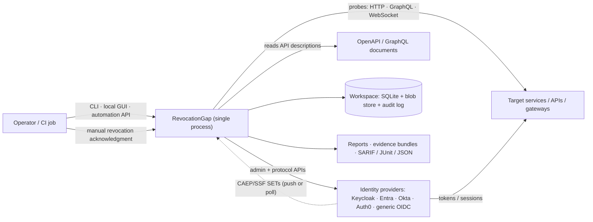
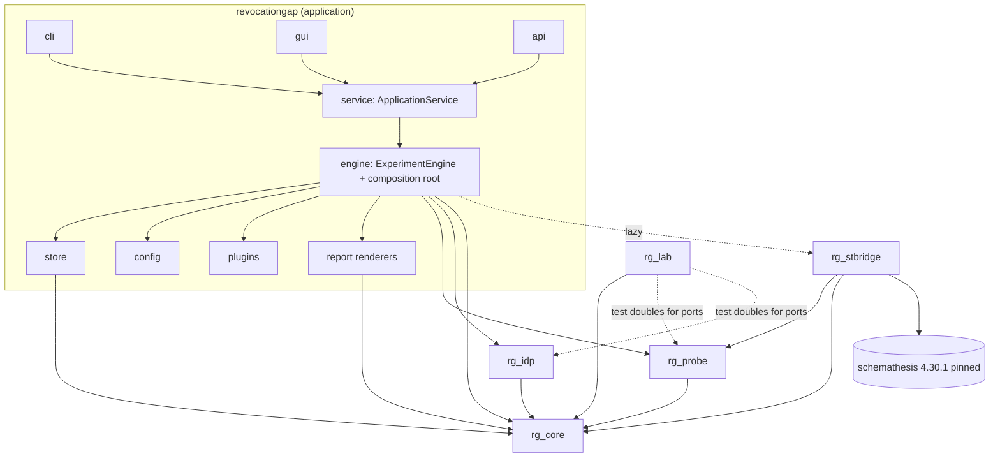

# RevocationGap — System Architecture (RG-P03-001)

**Status:** frozen contract (v1.0 draft). Changes require an entry in [`CONTRACT-CHANGELOG.md`](CONTRACT-CHANGELOG.md). Companions: [`DATA-MODEL.md`](DATA-MODEL.md) (shared types, enums, IDs), [`INTERFACE-CONTRACTS.md`](INTERFACE-CONTRACTS.md) (ports and signatures), [`COMPONENT-CATALOG.md`](COMPONENT-CATALOG.md) (component → owning element), [`DECISIONS/`](DECISIONS/) (ADR-0001…0014). Research basis: [`../02-RESEARCH/`](../02-RESEARCH/).

## 1. Architectural goals and quality attributes

| # | Attribute | Architectural response |
|---|---|---|
| QA-1 | **Measurement validity** (the product's credibility) | Immutable evidence + separate derivations (ADR-0013); dual-clock instants with explicit uncertainty (ADR-0006); controls and baselines mandatory in the experiment state machine (RG-P02-007). |
| QA-2 | **Provider independence of the temporal core** | `rg_core` is pure domain; providers appear only behind ports (`rg_core.ports.*`). |
| QA-3 | **Reuse of Schemathesis without coupling** | Single importer `rg_stbridge`; port + required fallback transport (ADR-0001). |
| QA-4 | **Determinism and testability** | Injectable `Clock`/`Scheduler`/transports; virtual-time lab (ADR-0014); no hidden globals. |
| QA-5 | **Safety** | Scope document + action classes + audit log (ADR-0011); secrets by handle; plugin allow-list (ADR-0009). |
| QA-6 | **Simplicity** | One process, one SQLite store, one HTTP stack; no brokers or microservices (ADR-0003/4/5). Distributed workers are a *future* extension point only (§11). |
| QA-7 | **Cross-platform** | Pure Python, wheels for Windows/Linux/macOS; `pathlib` paths; portable file-lock abstraction; no POSIX-only primitives in core. |
| QA-8 | **Extensibility** | Entry-point plugins for adapters, transports, actions, assertions, renderers, scenario packs, baselines (ADR-0009). |

## 2. System context



External actors: operator (human or CI), identity providers (admin and protocol endpoints), target services, event sources (CAEP/SSF transmitters, provider logs), the filesystem workspace. No other network egress (update checks are opt-in; offline operation supported, RG-P11-006).

## 3. Packages, layers and the dependency rule

| Layer | Package (distribution) | Responsibility | Allowed third-party deps |
|---|---|---|---|
| 5 Interfaces | `revocationgap.cli`, `.gui`, `.api` (app) | Thin adapters over `ApplicationService` | click, rich, fastapi, uvicorn, jinja2 |
| 4 Application | `revocationgap.{engine,service,config,store,report,plugins}` (app) | Orchestration, composition root, persistence, report rendering, configuration, plugin loading | pydantic, jinja2, stdlib sqlite3, platformdirs, cryptography (evidence encryption) |
| 3 Adapters | `rg_idp` (`revocationgap-idp`) | Identity providers: generic OIDC (Authlib), Keycloak, Entra, Okta, Auth0, session-cookie adapter, SSF/CAEP | authlib, joserfc, requests |
| 3 Adapters | `rg_probe` (`revocationgap-probe`) | Probe runner, raw HTTP transport, WebSocket probe, assertions, rate limiting, result normalisation | requests, websockets |
| 3 Adapters | `rg_stbridge` (`revocationgap-stbridge`) | **Only** importer of Schemathesis: operation catalog, `StHttpTransport`, baseline/scenario generation | schemathesis (pinned), (transitively hypothesis, pytest, werkzeug…) |
| 3 Test doubles | `rg_lab` (`revocationgap-lab`) | Mock IdP, mock services, fault/clock injection, fixtures, Keycloak lab helper | starlette, uvicorn (lab only) |
| 1–2 Domain | `rg_core` (`revocationgap-core`) | Time, temporal state model, events, expectations, observations, experiment state machine, analysis (alignment, correlation, exposure window, confidence, classification), scenario DSL, report data contracts, **ports** (Protocols) | pydantic only |

**Dependency rule (enforced by import-linter in CI):** imports point downward/inward only.
`rg_core` → nothing in RG. `rg_idp`, `rg_probe` → `rg_core`. `rg_stbridge` → `rg_core`, `rg_probe`, `schemathesis`. `rg_lab` → `rg_core` (and may import `rg_idp`/`rg_probe` *protocol modules* for conformance helpers) and never `rg_stbridge`. `revocationgap` (app) → all. **No package other than `rg_stbridge` may import `schemathesis`, `hypothesis` or `pytest`** (the app imports `rg_stbridge` lazily, only when a Schemathesis-backed probe source is configured). `rg_core` performs no I/O: no sockets, no files, no subprocesses, no wall-clock reads (ADR-0006).



**Why six distributions** (ADR-0003): each seam is justified by dependency weight or genuine reuse — `rg_core` embeddable with only pydantic; `rg_idp` reusable by any OAuth tooling; `rg_probe` usable without Schemathesis; `rg_stbridge` quarantines the heavy, fast-moving cone; `rg_lab` is test-only weight. Store, engine, renderers stay in the app (reuse value < packaging cost; reviewed again in RG-P14-001).

**Reusable components named in the master prompt → location:** temporal experiment engine = `rg_core.experiment` (state machine) + `revocationgap.engine` (driver); authorization probe engine = `rg_probe`; OAuth/OIDC adapter library and IdP connector framework = `rg_idp`; event correlation engine, state-transition engine, confidence/evidence analysis library = `rg_core.analysis`, `rg_core.experiment`; secure evidence serialisation = `rg_core.evidence` (format) + `revocationgap.store` (encrypted persistence); report generation = data contracts in `rg_core.report`, renderers in `revocationgap.report`; scenario DSL = `rg_core.scenario`.

## 4. Ports and adapters (hexagonal)

All cross-package behaviour is expressed as `typing.Protocol` classes in `rg_core.ports.*` (signatures in `INTERFACE-CONTRACTS.md`). A port is **owned** by the module-spec element named in the interface index; implementations live in the package listed there. The domain and engine depend only on ports; adapters are bound in the composition root (§6.3) from configuration and plugins. Every port has at least two implementations (a real one and a deterministic test double in `rg_lab` or `rg_core.testing`), which is the architectural test of whether the port is real.

| Port | Defined in | Real implementations | Test doubles |
|---|---|---|---|
| `Clock`, `Scheduler` | `rg_core.ports.time` | `SystemClock`/`AsyncioScheduler` (rg_core) | `VirtualClock`/`VirtualScheduler` (rg_core) |
| `EventBus` | `rg_core.ports.events` | `InProcessEventBus` (rg_core) | same, synchronous mode |
| `ExperimentStore`, `EvidenceStore`, `AuditLog` | `rg_core.ports.store` | SQLite/blob (app) | in-memory (rg_core.testing) |
| `IdentityProviderAdapter` (+ `ProviderCapabilities`, `CredentialAcquirer`, `TokenOracle`, `AdminControl`, `EventSource`) | `rg_core.ports.idp` | generic OIDC, Keycloak, Entra, Okta, Auth0 (rg_idp) | mock IdP adapter (rg_lab) |
| `RevocationAction` | `rg_core.ports.revocation` | actions packaged with adapters (rg_idp), manual (app) | scripted action (rg_lab) |
| `HttpTransport` | `rg_probe.transport` | `RawHttpTransport` (rg_probe), `StHttpTransport` (rg_stbridge) | `InProcessAppTransport` (rg_lab) |
| `WebSocketSession` | `rg_probe.websocket` | `websockets` adapter (rg_probe) | scripted WS server (rg_lab) |
| `Assertion` | `rg_core.ports.assertions` (pure functions over normalised exchanges) | built-ins (rg_probe) + plugins | — |
| `ReportRenderer` | `rg_core.ports.report` | HTML/Markdown/JSON/SARIF/JUnit (app) | golden renderer |
| `SecretResolver` | `rg_core.ports.secrets` | env, OS keyring, file (app) | in-memory |

## 5. Runtime model

* **One process, one asyncio event loop per experiment run**, owned by the `ExperimentEngine`. Structured concurrency: a run's tasks live in a single `asyncio.TaskGroup`; cancellation is cooperative and propagates from the run scope (RG-P03-005).
* **Blocking work is offloaded** to three bounded executors — `probe` (ST/requests probes), `idp` (Authlib/requests admin and protocol calls), `store` (SQLite writes) — so a slow target cannot delay scheduling or persistence (ADR-0004). WebSocket sessions, the optional CAEP receiver (HTTP server) and the GUI server run natively on the loop.
* **Timing discipline:** probe send times are scheduled on the monotonic clock via the `Scheduler`; the worker thread stamps `t_send_start`/`t_recv_end` immediately around the blocking call and the scheduler records *scheduling lateness* (`actual − intended` dispatch) on every observation (feeds uncertainty, RG-P02-006).
* **Backpressure:** all queues are bounded (event bus subscribers, probe submission, store writer); overflow policies are explicit per queue (`block`, `drop_oldest_noncritical`, `fail`) and *evidence-bearing* queues are never lossy (store writer blocks; probes slow down and the lateness is recorded).
* **Determinism:** with `VirtualClock`+`VirtualScheduler` and in-process transports, a full experiment executes without wall-time waiting and with a fixed event order (ties broken by `(due_mono_ns, submission_seq)`).
* **Process model for CLI/GUI:** the CLI runs the engine in the foreground; the GUI/API server hosts the engine in the same process and runs experiments as background tasks (one active experiment per workspace in v1; the workspace lock enforces it). A crash is recoverable from the store (RG-P11-005).

## 6. Core flows

### 6.1 Experiment lifecycle (authoritative sequence; states formalised in RG-P02-007)

```mermaid
sequenceDiagram
  autonumber
  participant U as Operator
  participant S as ApplicationService
  participant E as ExperimentEngine
  participant SC as Scope/Audit
  participant A as IdP adapter
  participant P as Probe runner
  participant T as Target
  participant ST as Store
  U->>S: run(experiment_spec)
  S->>E: start
  E->>SC: validate scope + action classes (DRAFT→VALIDATED)
  E->>A: capabilities(); acquire credentials for test identities
  E->>P: preflight: negative controls (no/garbage credential)
  E->>P: BASELINING: probes with each credential (must establish access)
  P->>T: request(s) (stamped t_send/t_recv)
  P->>ST: Observations + evidence
  E->>E: ARMED (all baselines + controls valid)
  E->>A: REVOKING: execute RevocationAction (or wait for manual ack)
  A-->>E: RevocationEvent(requested_at, acknowledged_at, ack_state)
  E->>P: OBSERVING: scheduled post-event probes (dense→backoff; confirmation tail)
  P->>T: probes · connection checks · refresh attempts
  P->>ST: Observations + evidence
  E->>E: stop rule met (stable denial) or horizon reached
  E->>E: ANALYZING: align clocks → correlate → exposure window → classify
  E->>ST: derived records (Findings) + report data
  E->>A: CLEANING_UP: restoration plan (re-enable, re-assign) — always attempted
  E-->>S: COMPLETE | INCONCLUSIVE | FAILED | ABORTED
```

### 6.2 Data flow and trust boundaries

Credentials flow only through `SecretResolver` handles → `CredentialAcquirer` → in-memory `CredentialMaterial` (never serialised) → `HttpTransport` per-call kwargs. Everything that crosses into the store passes the **redaction gate** (RG-P03-004/P11-001): secrets replaced by `${RG:<handle>:<fingerprint>}`, tokens reduced to fingerprint + decoded non-secret header/claims allow-list. Raw bodies/headers captured as evidence are stored *redacted* by default; an operator option enables encrypted unredacted capture (RG-P11-003). Untrusted inputs: target responses, API descriptions, IdP responses, CAEP events, plugin manifests, config files, GUI/API requests (localhost-only, token-authenticated).

### 6.3 Composition root and dependency injection

`revocationgap.engine.compose(config, plugins) -> RunContext` builds ports once per run: clock/scheduler (system or virtual per `--lab virtual`), event bus, store, audit log, secret resolver, adapters (by provider id from the target config), transports (by probe `transport` kind), assertion registry, renderers. No module reads globals or environment variables except the config subsystem and `SecretResolver`. Constructor injection only; no service locator inside domain code. `RunContext` is passed explicitly; it is immutable after construction.

## 7. Persistence and workspace layout

```
<workspace>/
  revocationgap.toml            # project config (RG-P03-003)
  scope.toml                    # authorised scope document (RG-P11-002) — separate file, versioned
  .rg/store.sqlite3             # WAL; experiments, observations, timeline, findings, derived records, run index, audit log mirror
  .rg/blobs/ab/cdef...          # content-addressed evidence blobs (sha256), optionally encrypted
  .rg/audit.log                 # append-only JSON lines, hash-chained
  .rg/lock                      # single-writer workspace lock (portable)
  scenarios/ *.yaml             # user scenarios (RG-P07-001)
  reports/<experiment-id>/      # rendered outputs
```

The store is append-only for facts (observations, events, evidence); derived records are versioned by `algorithm_id@version` and replaceable (ADR-0013). Details: RG-P03-008.

## 8. Extension and plugin architecture

Entry-point groups (ADR-0009) with `api_version` compatibility and capability manifests; plugin discovery lists everything installed, but only allow-listed ids load. Extension points: identity adapters, revocation actions, transports, assertions, report renderers, scenario packs, enforcement baselines. Plugin API surface = the ports plus `rg_core.model` types; plugins must not import `revocationgap.*` application internals (checked by a conformance linter in RG-P12-003).

## 9. Cross-cutting concerns

| Concern | Decision | Specified in |
|---|---|---|
| Configuration | Layered: defaults < `revocationgap.toml` < env (`RG_*`) < CLI flags; parsed (syntax) separately from validated (semantics, scope); unknown keys are errors | RG-P03-003 |
| Logging | stdlib `logging` + structured JSON; correlation ids (`experiment_id`, `probe_id`); redaction filter mandatory on all handlers | RG-P03-004 |
| Errors | Single hierarchy `RgError(category, code, retryable, details)`; categories in `DATA-MODEL.md` §6 | RG-P03-005 |
| Secrets | Handles + resolver; memory-only material; `Secret` wrapper never reprs values | RG-P11-001 |
| Time | Only via `Clock`; lint rule RG-LINT-001 bans `time.time`, `time.monotonic`, `datetime.now`, `asyncio.sleep` in `rg_core`, `rg_probe`, `rg_idp`, `rg_stbridge`, engine | RG-P02-001, RG-P12-001 |
| Versioning | Documents carry `schema_version`; migrations forward-only with backup | RG-P03-002, RG-P11-006 |
| Observability | Metrics are events on the bus (`probe_latency`, `scheduling_lateness`, `queue_depth`) rendered in GUI and exported in run summary | RG-P03-007 |

## 10. Deployment model (cross-platform; RG-P03-011)

* **Developer/operator workstation (Windows/Linux/macOS):** `pipx`/`uv tool install revocationgap` (wheels; pure Python plus binary wheels of pydantic-core, jsonschema-rs, cryptography); `rg` console script; GUI at `http://127.0.0.1:<port>/?t=<token>`.
* **CI:** same wheel in a container or runner; `rg run … --junit --sarif`; exit codes encode outcome classes.
* **Laboratory:** `rg lab up` starts the mock IdP/services; optional Keycloak container via Docker/Podman compose (`lab-assets/keycloak`) or a locally unpacked Keycloak distribution (the research lab ran from the zip, V-lab).
* **Offline:** wheelhouse installation; no network access except configured targets; update checks disabled by default.

## 11. Future extension points (design allowances only; not specified for MVP)

* **Distributed workers:** `ExperimentSpec` is fully serialisable and secret-free; probes are described by `ProbeSpec`; observations are append-only records keyed by `experiment_id`+`seq`; therefore a worker process can run a probe subset and stream observations to a coordinator over the same `EventBus`/`ExperimentStore` ports. No change to `rg_core` is required (RG-P14-001).
* **Multiple simultaneous IdP comparison:** multiple adapters per experiment are already allowed by the data model (`Experiment.providers[]`).
* **gRPC / other transports:** new `HttpTransport`-like ports via plugins.

## 12. ADR index

| ADR | Title |
|---|---|
| 0001 | Schemathesis as pinned upstream foundation behind an adapter |
| 0002 | Python 3.11+ runtime |
| 0003 | Six distributions with enforced one-way dependencies |
| 0004 | One synchronous HTTP stack + asyncio orchestration with bounded thread offload |
| 0005 | SQLite WAL + content-addressed blobs |
| 0006 | Dual-clock instants with explicit uncertainty; injectable Clock/Scheduler |
| 0007 | pydantic v2 frozen models as shared contract/schema source |
| 0008 | click CLI; FastAPI + htmx GUI; shared ApplicationService |
| 0009 | Entry-point plugins, trusted-by-installation |
| 0010 | Outcome taxonomy and policy profiles |
| 0011 | Safe-by-default execution; scope document; action classes |
| 0012 | Reproducibility by serialised spec + snapshots |
| 0013 | Evidence collection and interpretation separated |
| 0014 | Lab dual mode (virtual-time / real-time) |

## 13. Requirement-area to architecture mapping

Requirement ids are defined in [`../03-PRODUCT/PRODUCT-REQUIREMENTS.md`](../03-PRODUCT/PRODUCT-REQUIREMENTS.md); the generated [`../REQUIREMENTS-TRACEABILITY.md`](../REQUIREMENTS-TRACEABILITY.md) gives the per-requirement module/interface/test mapping once module specs exist. Area-level allocation (frozen here so parallel authors cite consistent owners):

| Area | Primary package / modules | Elements (spec owners) |
|---|---|---|
| FR-TEMP | `rg_core.time`, `.model.*`, `.experiment`, `.analysis.window` | RG-P02-001…009, RG-P08-004 |
| FR-EXP | `revocationgap.engine`, `rg_core.experiment` | RG-P02-007, RG-P03-010, RG-P11-005 |
| FR-IDP | `rg_idp.*`, `rg_core.ports.idp` | RG-P04-001…011 |
| FR-REV | `rg_core.ports.revocation`, `rg_idp.actions.*`, `revocationgap.engine.manual` | RG-P06-001…010 |
| FR-PRB | `rg_probe.*`, `rg_core.ports.assertions` | RG-P05-001…004, 006…014 |
| FR-ST | `rg_stbridge.*` | RG-P05-005, RG-P05-012, RG-P07-005 |
| FR-SCN | `rg_core.scenario`, scenario packs | RG-P07-001…005 |
| FR-EVD | `rg_core.evidence`, `revocationgap.store` | RG-P03-008, RG-P08-001, RG-P11-003 |
| FR-ANA | `rg_core.analysis.*`, `revocationgap.history` | RG-P02-009, RG-P08-002…010 |
| FR-RPT | `rg_core.report`, `revocationgap.report` | RG-P08-011 |
| FR-LAB | `rg_lab.*` | RG-P09-001…006 |
| FR-CLI / FR-GUI / FR-API | `revocationgap.cli`, `.gui`, `.api`, `.service` | RG-P10-001…007 |
| FR-SEC | `rg_core.scope`, `rg_core.logging` (redaction), `revocationgap.secrets`, audit | RG-P11-001…004, RG-P03-004 |
| FR-OPS | `revocationgap.config`, `.doctor`, `.migrate` | RG-P03-003, RG-P11-006, RG-P03-011 |
| FR-EXT | `rg_core.ports.plugins`, `revocationgap.plugins` | RG-P03-009, RG-P11-004 |
| FR-HIST | `revocationgap.history` | RG-P08-009 |
| NFR-* | cross-cutting; verification in Phase 12 | RG-P12-001…006, RG-P13-001…004 |

**Time source decision carried from the PRD (NFR-PERF-002):** `Clock.mono_ns()` is backed by `time.perf_counter_ns()`; `rg_core.testing`/lint rules ban direct clock calls elsewhere.
