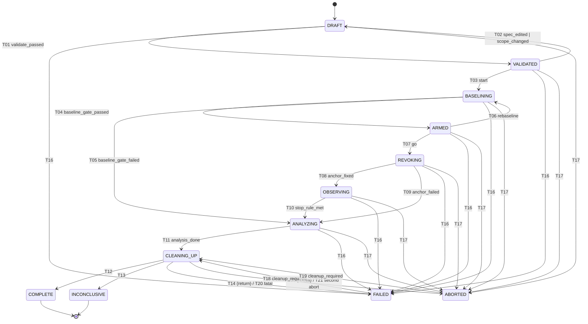

# RG-P02-007 — Experiment state machine and transitions

> Scope: the **formal machine** that governs one experiment run — states, triggers, guards, actions (as engine *directives*), durable-commit requirements, recovery behaviour — plus the `Experiment`/`ExperimentSpec`/`Transition` schemas and the model-test specification. The machine is a **pure transition function** (`IF-EXP-MACHINE`); the engine (RG-P03-010) performs the side effects, the store (RG-P03-008) makes commits durable, recovery orchestration (RG-P11-005) executes the recovery table defined here.

## 1. Module identifier and name

| Item | Value |
|---|---|
| Element | RG-P02-007 — Experiment state machine and transitions |
| Package / modules | `rg_core.experiment` (`machine`, `table`, `recovery`, `runtime`), `rg_core.model.experiment` |
| Module id | `MOD-CORE-EXPERIMENT_STATE_MACHINE` |
| Schemas | `SCH-EXPERIMENT`: `Experiment`, `ExperimentSpec`, `ExperimentRuntime`, `Transition`, `Trigger`, `Facts`, `StepResult`, `RecoveryDecision` |
| Interface | `IF-EXP-MACHINE` — `ExperimentMachine` |
| Data file | `rg_core/experiment/transitions.yaml` (authoritative table, §11.2; generated into tests) |

## 2. Phase and requirement references

| Requirement | Realised by |
|---|---|
| FR-TEMP-012 states DRAFT…terminal per published transition table with guards; reject any transition not in the table | §11 table, §7 `step` (`RGE-INTERNAL-0701`) |
| FR-EXP-001 declarative secret-free spec, digest in manifest | §8.2 `ExperimentSpec`, `spec_digest` |
| FR-EXP-002 pre-arming validation | guard G-VAL of T01 |
| FR-EXP-003 baseline & control gate: no ARMED unless baselines confirmed and controls denied; else `INCONCLUSIVE` with the failed control named | T04/T05, guard G-BASE |
| FR-EXP-004 arming confirmation naming tenant/realm; scope digest pinned | G-ARM (T03) |
| FR-EXP-005 settle interval | G-GO (T07) using RG-P02-003 `settle_check` |
| FR-EXP-006 stop rules; record which rule ended observation | T10, `StopReason` |
| FR-EXP-007 guaranteed cleanup after any run that mutated state, regardless of outcome | CLEANING_UP discipline, INV-4/INV-5 |
| FR-EXP-008 interrupted-run recovery from durable records via a published recovery table | §11.3 recovery table |
| FR-EXP-009 multi-credential/target runs: gate is per credential, outcomes per (credential, target) | G-BASE, T11 disposition rule |
| FR-EXP-010 one active experiment per workspace | G-LOCK |
| FR-REV-012 restoration ledger written before executing | directive ordering in REVOKING/BASELINING; recovery rows |
| FR-EVD-008 timeline records transitions | commit protocol §10.2 |
| NFR-REL-004 resource cleanup: the workspace lock is released at every final transition and by recovery after cleanup (directive `release_workspace_lock`) | §10.3, T12–T15, T20–T21 |
| NFR-REL-001 transitions durable before the engine acts on them; NFR-PERF-010 recovery | §10.2, §11.3 |
| NFR-REL-002 determinism; NFR-TEST-002 state-machine model tests | pure function; §22 model tests |

Workflows and validity rules: **WF-01** (happy path and F1–F7), **WF-04** (manual revocation, M1/M2, F1–F5), **WF-11** (interrupted-run recovery), TV-01/TV-02/TV-06/TV-15, TM-05/TM-06 (arming, scope pinning), SV-006 (unacknowledged revoke ⇒ no exposure claim). Scenarios: all.

## 3. Purpose and user/security value

An experiment that mutates identities and then crashes, is aborted, or measures from an invalid baseline is the product's worst failure mode: it leaves a disabled synthetic user behind, or publishes an exposure interval anchored on nothing. The machine makes every such path explicit and *checkable*: the order of states enforces "controls before revocation" and "acknowledgment before observation"; every state that may have mutated the environment funnels through a mandatory, idempotent `CLEANING_UP`; every transition is durable before the engine acts, so a crash at any instruction boundary lands on exactly one row of the recovery table. Because the machine is a pure function with a data-file table, it is exhaustively model-testable and reviewable by non-implementers.

## 4. Explicit responsibilities

- **RESP-1** Define the 12 states, the triggers, the complete transition table with guard, directives, commit requirement and recovery note.
- **RESP-2** Reconcile the machine with USER-WORKFLOWS §3 / WF-11 (placement of ARMED, meaning of CLEANING_UP after FAILED/ABORTED, INCONCLUSIVE vs COMPLETE) and state the reconciliation as normative.
- **RESP-3** Define `ExperimentRuntime` (the projection of the transition log), finality, and the cleanup discipline.
- **RESP-4** Define `ExperimentSpec` (top-level shape, secret-free, digest) and `Experiment` (snapshot) schemas and `Transition` records.
- **RESP-5** Define the pure interface `ExperimentMachine` (`step`, `enabled`, `table`, `recover`, `is_final`, `due_timeout`).
- **RESP-6** Define the commit protocol (what is committed atomically, when the engine may act).
- **RESP-7** Define the recovery table keyed by last durable state (consumed by RG-P11-005) and the operator recovery choices.
- **RESP-8** Specify the model-test suite (state-machine property tests, crash-injection harness).

## 5. Out-of-scope responsibilities

| Excluded item | Owner |
|---|---|
| Executing directives (provisioning, probing, revoking, cleanup), task structure, cancellation plumbing | RG-P03-010 (engine), RG-P03-005 (async model) |
| Durable storage, CAS implementation, single-writer lock | RG-P03-008, RG-P11-002 (lock/scope) |
| Recovery orchestration UX and commands | RG-P11-005, RG-P10-003 |
| Probe scheduling and stop-rule *evaluation* (tail confirmation) | RG-P05-008, RG-P08-004 (the machine only receives `stop_rule_met` + reason) |
| Scope validation, tenant confirmation token format | RG-P11-002 |
| Classification/aggregate outcome computation | RG-P02-009 (the machine uses its result for `return_to`) |
| Restoration ledger content, inverse actions | RG-P06-001, RG-P06-010 |
| Timeline entry schema | RG-P02-008 |
| Sub-schemas embedded in `ExperimentSpec` (`ProbeSpec`, `ScenarioSpec`, action plans) | RG-P05-001, RG-P07-001, RG-P06-001 |

## 6. Dependencies and prerequisites

RG-P02-005 (`ExpectationSet`, profiles), RG-P02-006 (`Confidence`, observation semantics, control semantics), transitively RG-P02-001…004 (`TimeInstant`, `Identity`, `Credential`/`settle_check`, `RevocationEvent`/`AckState`/`AnchorInterval`), RG-P03-002 (`Model`, `Document`, `Provenance`, `digest`, typed ids), `ExperimentStore` (INTERFACE-CONTRACTS §3). DATA-MODEL §3 (`ExperimentState`, `OutcomeClass`, `PolicyProfile`), §7 (`Experiment`), §9. USER-WORKFLOWS §3, WF-01, WF-04, WF-11; SYSTEM-ARCHITECTURE §6.1 (lifecycle sequence). Pure Python + pydantic v2; no I/O, no clock reads.

## 7. External and internal interfaces

### 7.1 `ExperimentMachine` — IF-EXP-MACHINE (`rg_core.experiment`)

All methods are synchronous, pure, deterministic, thread-safe, idempotent.

```python
class ExperimentMachine:
    @staticmethod
    def initial(experiment_id: str, spec_digest: Sha256Digest, *, at: TimeInstant) -> ExperimentRuntime: ...     # state DRAFT, seq 0

    @staticmethod
    def step(rt: ExperimentRuntime, trigger: Trigger, facts: Facts, *, at: TimeInstant) -> StepResult: ...
    # trigger not allowed in rt.state            → raises RgError RGE-INTERNAL-0701 (details: state, trigger)
    # trigger allowed but a guard is false       → StepResult(applied=False, blocked_by=(guard ids…)); no error
    # trigger allowed and all guards true        → StepResult(applied=True, new=…, transition=…, directives=…, commit=…)

    @staticmethod
    def enabled(rt: ExperimentRuntime, facts: Facts) -> tuple[Trigger, ...]: ...                              # triggers whose guards currently hold (for UI/engine polling)
    @staticmethod
    def table() -> tuple[TransitionSpec, ...]: ...                                                              # §11.2 rows as data
    @staticmethod
    def is_final(rt: ExperimentRuntime) -> bool: ...                                                            # §11.1
    @staticmethod
    def due_timeout(rt: ExperimentRuntime, now: TimeInstant, cfg: StateTimeouts) -> Trigger | None: ...        # §12.4
    @staticmethod
    def disposition(findings: Sequence[FindingSummary]) -> Literal["COMPLETE", "INCONCLUSIVE"]: ...            # §12.3
    @staticmethod
    def recover(last: ExperimentRuntime, durable: RecoveryFacts, policy: RecoveryPolicy) -> RecoveryDecision: ...   # §11.3
    @staticmethod
    def validate_table() -> None: ...                                                                           # self-check at import (RGE-INTERNAL-0702)
```

`Directive` is a value naming an engine action (not executing it); the closed set is in §11.2 column "Directives" (`pin_spec_digest`, `release_arming`, `record_arming`, `start_guard_task`, `provision_identities`, `acquire_credentials`, `wait_settle`, `run_controls`, `run_baseline`, `freeze_snapshots`, `write_ahead_event`, `execute_revocation`, `await_manual_ack`, `schedule_probes`, `stop_probes`, `drain_inflight`, `run_analysis`, `persist_derived`, `start_cleanup`, `verify_restoration`, `release_workspace_lock`, `record_failure`, `record_abort`, `emit_report_data`). `CommitRequirement ∈ {durable_full, durable_batched}` (§10.2).

### 7.2 Error codes (block 0700–0799 (RG-P03-005 §8.3))

| Code | Name | Raised by |
|---|---|---|
| RGE-INTERNAL-0701 | `illegal_transition` — `(state, trigger)` not in the table (also surfaced to operators as a typed "not allowed now" by `ApplicationService`) | `step` |
| RGE-INTERNAL-0702 | `runtime_invalid` — runtime violates an invariant (e.g. `cleanup_epoch > 1`, final state with pending cleanup) or table self-check fails | `validate_table`, runtime validator |
| RGE-CONFIG-0703 | `spec_invalid` — `ExperimentSpec`/`Experiment` validation failure | model validators |
| RGE-CONFIG-0704 | `arming_invalid` — confirmation does not name the declared tenant/realm ids, or scope digest differs from the pinned one | `Facts` builder / guard G-ARM (reported, not raised, by `step`; raised by `record_arming` helper) |
| RGE-STORE-0705 | `transition_conflict` — CAS on `(experiment, from-state)` failed (another writer, stale runtime) | commit protocol (engine/store) |
| RGE-INTERNAL-0706 | `facts_invalid` — `Facts` inconsistent with the trigger (e.g. `stop_rule_met` without `stop_reason`) | `step` |
| RGE-CONFIG-0707 | `recovery_policy_invalid` | `recover` |
| RGE-INTERNAL-0708 | `recovery_inconsistent` — durable facts contradict the table (e.g. state `OBSERVING` without an acknowledged event) | `recover` |

## 8. Data structures and schemas

Conventions as RG-P02-001 §8 (frozen `Model`s; `Int64` ns; validator messages begin with the RGE code; `None` omitted). `Experiment`, `ExperimentSpec`, `Transition` are `Document`s (`SCHEMA_ID` `experiment`, `experiment_spec`, `transition`; `1.0`).

### 8.1 `Experiment` (immutable snapshot; state is a projection of the transition log)

| Field | Type | Constraint | Description |
|---|---|---|---|
| `schema_version`, `derivation`, `produced_by` | | | provenance |
| `id` | `ExpId` | | frozen name |
| `scenario_ref` | `ScnId` | | frozen name |
| `spec_digest` | `Sha256Digest` | = digest of the stored `ExperimentSpec` (`rg.spec.v1`) | frozen name |
| `state` | `ExperimentState` | | frozen name (value at snapshot time) |
| `providers`, `targets`, `identities` | `tuple[PrvId,…]`, `tuple[TgtId,…]`, `tuple[IdnId,…]` | ≥ 1 each | frozen names (references) |
| `events` | `tuple[RevId,…]` | append-only across snapshots | frozen name |
| `started_at` | `TimeInstant \| None` | set by T03 | frozen name |
| `ended_at` | `TimeInstant \| None` | present iff `is_final` | frozen name |
| `policy_profiles` | `tuple[PolicyProfile,…]` | ≥ 1; first = **primary profile** | frozen name |
| `lab_mode` | `Literal["virtual","realtime"] \| None` | | frozen name |
| `tool_versions` | `Mapping[Label, ShortText]` | ≤ 64 | frozen name (also in manifest) |
| `clock_kind` | `ClockKind` | `system`/`virtual` | additive (FR-EVD-007) |
| `runtime` | `ExperimentRuntime` | | additive: the projection below |

### 8.2 `ExperimentSpec` (secret-free; digest recorded)

| Field | Type | Constraint | Description |
|---|---|---|---|
| `schema_version`, `spec_version` | | | `spec_version` = author's revision (Count) |
| `name` | ShortText | | |
| `scenario_ref`, `scenario_id` | `ScnId`, ScenarioSlug (`scn.<slug>@<n>`) | | scenario instance and definition |
| `providers` | `tuple[ProviderDecl, …]` | ≥ 1 | `{id: PrvId, adapter_id: Slug ("idp.keycloak"), issuer: URL \| None, adapter_config: bounded secret-free mapping (≤ 64 KiB), admin_credential: SecretHandle}` |
| `targets` | `tuple[TargetDecl, …]` | ≥ 1 | `{id: TgtId, kind: http_api\|graphql\|websocket, base_url, validation_mode: ValidationMode, description_source, scope_ref, enforcement_profile_ref?}` (DATA-MODEL §7) |
| `identities` | `tuple[Identity, …]` | ≥ 1 | RG-P02-002 (synthetic only) |
| `credential_plan` | `tuple[CredentialPlanItem, …]` | | `{identity_ref, flow, type, format, role: CredentialRole, slot_key?, client_ref?, issuer_role}` |
| `probes` | `tuple[ProbeSpec, …]` | ≥ 1 | RG-P05-001 |
| `revocation` | `RevocationStep` | | `{kind, mode: automated\|manual, action_id, params (bounded, secret-free), affects: tuple[AffectSelector,…], restoration: bool}` (RG-P06-001 owns action semantics) |
| `controls` | `ControlPlan` | | `{none_credential: bool=true, garbage_credential: bool=true, sibling: bool, foreign: bool}`; `none`/`garbage` default **true** and may not be disabled without an audited `waiver` string |
| `expectations` | `ExpectationSet \| None` | `origin="operator"` | operator rules (RG-P02-005) |
| `baselines` | `tuple[Label,…]` | | baseline set ids requested (`baseline.keycloak.admin-guide@26.8`) |
| `policy_profiles` | `tuple[PolicyProfile,…]` | ≥ 1 | |
| `timing` | `TimingPlan` | | `settle_ns`, `baseline_timeout_ns`, `armed_ttl_ns`, `ack_timeout_ns` (automated), `manual_ack_timeout_ns`, `horizon_ns`, `n_confirm`, `t_confirm_ns` (default rule §DATA-MODEL 4), `baseline_max_age_ns`, `rebaseline_max`, `require_go_after_baseline`, `schedule_ref` |
| `scope` | `ScopeBinding` | | `{scope_digest_required: bool, tenant_ids: tuple[Label,…], confirmation_required: bool}`; the pinned digest itself is runtime data |
| `clock_kind`, `lab_mode`, `seed` | | | determinism inputs (ADR-0012) |

`spec_digest = digest(canonical(ExperimentSpec), domain="rg.spec.v1")`. Size ≤ 1 MiB canonical (`experiment.max_spec_bytes`, `RGE-CONFIG-0703`). `ExperimentSpec` is validated in full at T01 (G-VAL); structural validation errors are reported together (FR-EXP-002).

### 8.3 `ExperimentRuntime` (projection; rebuilt by folding the transition log)

| Field | Type | Description |
|---|---|---|
| `experiment_id` | `ExpId` | |
| `state` | `ExperimentState` | |
| `seq` | Count | number of committed transitions (= last `Transition.seq`) |
| `entered_at` | `TimeInstant` | when `state` was entered (decision instant) |
| `epoch` | str \| None | clock epoch of `entered_at` (timeouts apply only within one epoch) |
| `mutated` | bool | the restoration ledger has ≥ 1 write-ahead or executed entry (setup or revocation) — monotone |
| `arming` | `ArmingRecord \| None` | `{confirmed_at, scope_digest, tenant_ids, token_digest}` set at T03 |
| `stop_reason` | `StopReason \| None` | why observation/baselining ended |
| `return_to` | `Literal["COMPLETE","INCONCLUSIVE","FAILED","ABORTED"] \| None` | set when entering `CLEANING_UP` |
| `cleanup_status` | `Literal["not_required","pending","running","done","partial","failed"]` | |
| `cleanup_epoch` | Count | 0 or 1: at most one cleanup phase per run |
| `rebaselines` | Count | |
| `recovery_count` | Count | number of recoveries applied |
| `analysis` | `Literal["none","partial","complete"]` | |
| `failure` | `FailureInfo \| None` | `{code: RGE code, reason: Label, detail: ShortText}` |
| `abort` | `AbortInfo \| None` | `{reason: AbortReason, actor: rg\|operator\|safety}` |
| `residual_count` | Count | residual unrestored items after cleanup |

Enums: `StopReason ∈ {tail_confirmed_all, horizon_elapsed, all_credentials_resolved, rate_limit_exhausted, baseline_failed, baseline_timeout, revocation_not_acknowledged}`; `AbortReason ∈ {operator_abort, disarm, arming_expired, scope_expired, scope_changed, quota_exceeded, rate_limit_safety_stop, recovery_abandon, second_abort}`; `FailureReason ∈ {adapter_error, probe_runner_error, store_error, analysis_error, analysis_timeout, invariant_violation, lab_unhealthy, crash_recovered, cleanup_unrecoverable}`.

### 8.4 `Transition` (persisted record; one per committed state change)

| Field | Type | Description |
|---|---|---|
| `schema_version`, `derivation=observed`, `produced_by` | | |
| `experiment_ref` | `ExpId` | |
| `seq` | Count ≥ 1 | gap-free per experiment |
| `from_state`, `to_state` | `ExperimentState` | |
| `trigger` | `Trigger` | |
| `transition_id` | Label | `T01`…`T21` (§11.2) |
| `at` | `TimeInstant` | decision instant (stamped before the commit) |
| `reason_code` | Label | e.g. `baseline_failed:negative_garbage`, `crash_recovered` |
| `facts_digest` | `Sha256Digest \| None` | digest of the canonical `Facts` that justified it (reproducibility) |
| `cleanup_epoch` | Count | after the transition |
| `recovery` | bool | applied by recovery |

```json
{"schema_version": "1.0", "experiment_ref": "exp_01M4QJ0B00M9S346Q3D25VT4F5", "seq": 6, "from_state": "ARMED", "to_state": "REVOKING",
 "trigger": "go", "transition_id": "T07",
 "at": {"wall_ns": "1791796860000000000", "mono_ns": "259990000000", "clock_id": "system", "read_cost_ns": "400", "epoch": "a1b2c3d4"},
 "reason_code": "go_given", "facts_digest": "sha256:0000000000000000000000000000000000000000000000000000000000000000",
 "cleanup_epoch": 0, "recovery": false, "derivation": "observed", "produced_by": {"component": "rg_core.experiment", "version": "1.0"}}
```

### 8.5 `Trigger`, `Facts`, `StepResult`, `RecoveryFacts`

`Trigger` (closed): `validate_passed`, `spec_edited`, `scope_changed`, `start`, `baseline_gate_passed`, `baseline_gate_failed`, `rebaseline`, `go`, `anchor_fixed`, `anchor_failed`, `stop_rule_met`, `analysis_done`, `cleanup_required`, `cleanup_finished`, `fatal_error`, `abort_requested`.
`Facts` (inputs to guards; built by the engine from durable records; **no I/O in the machine**): 

| Group | Fields |
|---|---|
| validation | `validation_errors: Count`, `scope_digest_current`, `scope_digest_pinned \| None` |
| arming | `arming_required: bool`, `arming_confirmed: bool` (record present and consistent), `arming_age_ns: Int64 \| None`, `armed_ttl_ns` |
| lock | `workspace_lock_held: bool` |
| baseline | `controls_passed: bool`, `baseline_ok_all_credentials: bool`, `graph_valid: bool`, `snapshots_frozen: bool`, `expected_delta_ok: bool`, `failed_control: Label \| None`, `baseline_age_ns: Int64 \| None`, `baseline_max_age_ns`, `rebaselines: Count`, `rebaseline_max` |
| go gate | `settle_slack_ns: Int64` (RG-P02-003 `SettleCheck.slack_ns`), `require_go: bool`, `go_given: bool` |
| revocation | `event_ack_state: AckState \| None`, `anchor_valid: bool`, `anchor_committed: bool`, `ack_timed_out: bool`, `verification_pending: bool` |
| observation | `stop_reason: StopReason \| None` |
| analysis | `derived_durable: bool`, `primary_findings: tuple[FindingSummary,…]` (`{credential_ref, target_ref, outcome: OutcomeClass}`), `analysis_ok: bool` |
| cleanup | `ledger_pending: bool`, `cleanup_done: bool`, `residual_count: Count` |
| error/abort | `fatal: FailureInfo \| None`, `abort: AbortInfo \| None`, `abort_count: Count` |

`StepResult`: `applied: bool`, `new: ExperimentRuntime`, `transition: Transition | None`, `directives: tuple[Directive,…]`, `commit: CommitRequirement`, `blocked_by: tuple[Label,…]`.
`RecoveryFacts`: `ledger: Literal["none","written_not_executed","executed_unverified","executed_verified","restored_partial","restored_all"]`, `event_versions: tuple[AckState,…]` (ack states of durable versions in order), `observations_durable: Count`, `derived_durable: bool`, `findings_durable: bool`, `cleanup_status`, `epoch_changed: bool`, `scope_digest_matches: bool`, `arming_present: bool`. `RecoveryPolicy ∈ {auto_restore, keep_evidence_only, abandon}` (WF-11 step 3). `RecoveryDecision`: `triggers: tuple[(Trigger, Facts-patch)]` to apply in order, `directives`, `final_state_hint`, `analysis: none|partial`, `notes`.

## 9. Inputs, outputs, and validation rules

| # | Rule | Code |
|---|---|---|
| VR-1 | `(rt.state, trigger)` must be a row of §11.2; otherwise reject | RGE-INTERNAL-0701 |
| VR-2 | `Facts` must carry the fields the trigger needs (`stop_rule_met` ⇒ `stop_reason`; `fatal_error` ⇒ `fatal`; `abort_requested` ⇒ `abort`; `analysis_done` ⇒ `primary_findings` and `derived_durable`) | RGE-INTERNAL-0706 |
| VR-3 | Runtime invariants (§11.4) hold after every `step` and on load | RGE-INTERNAL-0702 |
| VR-4 | `ExperimentSpec`: ≥ 1 identity/target/probe/profile; identities synthetic; credential plan references declared identities; `controls.none_credential` and `garbage_credential` true unless `waiver` set; `timing.horizon_ns ≥ 2 × t_confirm_ns`; `settle_ns ≥ credential.min_settle_ns`; size ≤ limit | RGE-CONFIG-0703 |
| VR-5 | Arming confirmation names exactly the spec's `tenant_ids` and the scope digest equals the pinned one | RGE-CONFIG-0704 |
| VR-6 | Commit: CAS `(experiment_ref, from_state, seq)`; conflict ⇒ stale writer | RGE-STORE-0705 |
| VR-7 | `RecoveryPolicy` ∈ enum; `abandon` only with explicit operator source | RGE-CONFIG-0707 |
| VR-8 | Recovery facts consistent with the last durable state (§11.3 "precondition" column) | RGE-INTERNAL-0708 |

## 10. Detailed execution behavior

### 10.1 Reconciliation with USER-WORKFLOWS §3 and WF-11 (normative)

| USER-WORKFLOWS statement | Normative resolution in this machine |
|---|---|
| Happy order `DRAFT → VALIDATED → ARMED → BASELINING → REVOKING → …` (ASM-UW-01) | **`DRAFT → VALIDATED → BASELINING → ARMED → REVOKING → OBSERVING → ANALYZING → CLEANING_UP → (COMPLETE\|INCONCLUSIVE)`** (DATA-MODEL §3 note, SYSTEM-ARCHITECTURE §6.1, FR-EXP-003: no ARMED before the baseline/control gate). The operator's **arming confirmation** (FR-EXP-004) is captured *before* `BASELINING` begins because provisioning is itself mutating; it is a recorded `operator_action` (`arm_confirmed`) in `VALIDATED` consumed by guard G-ARM of T03. `ARMED` therefore means "baseline gate passed, confirmation pinned, awaiting go/settle". User actions map as: *edit* → T02; *arm* → recorded confirmation; *start* → T03; *go/continue* (only if `require_go_after_baseline`) → trigger `go`; *disarm* → T17 (`AbortReason.disarm`); *abort* → T17; *confirm manual acknowledgment* → manual `RevocationEvent` version 2 + T08. (CONTRACT CHANGE REQUEST CCR-1: amend USER-WORKFLOWS §3 table and ASM-UW-01.) |
| `VALIDATED`: "nothing sent to targets" | Holds: T01 is guarded by a dry run that sends nothing; identities/credentials are acquired inside `BASELINING` (directive `provision_identities`/`acquire_credentials`). Pre-existing lab fixtures are outside the ledger. |
| `CLEANING_UP` "after any of ANALYZING, FAILED, ABORTED" | `ANALYZING → CLEANING_UP` always (an empty ledger makes it a durable no-op with `cleanup_status=not_required`); `FAILED`/`ABORTED → CLEANING_UP` only when the ledger has unrestored entries (`mutated ∧ ledger_pending`); `CLEANING_UP` then **returns to the terminal it came from** (`return_to`), so `FAILED`/`ABORTED` are *terminal-pending-cleanup* until the cleanup phase has run (§11.1). |
| `INCONCLUSIVE` terminal "outcome class INCONCLUSIVE" | Terminal `INCONCLUSIVE` ⇔ every primary-profile finding is `inconclusive` (or there is none); every other outcome class (`enforced`, `expected`, `documented_delay`, `risky_config`, `vulnerable`, `needs_verification`) is carried by `COMPLETE` (T11, §12.3). Early inconclusive exits (failed control, unacknowledged revocation) pass through `ANALYZING` so the classifier is the single source of outcome classes. |
| WF-11 "resuming OBSERVING automatically is v1.x" | MVP recovery never resumes `OBSERVING` (§11.3); a v1.x extension point is marked. |
| TM-06 "returning the experiment to DRAFT" on scope change | Realised exactly from `VALIDATED` (T02 with trigger `scope_changed`). From `BASELINING` onward the environment is already mutated, so a scope change **aborts** (`AbortReason.scope_changed`) and cleanup refuses automated restore if the pinned scope no longer matches (WF-11 F2). |

### 10.2 Commit protocol (NFR-REL-001)

1. The engine builds `Facts` from durable records and calls `step(rt, trigger, facts, at=clock.now())`.
2. If `applied`, the engine performs **one atomic store transaction** (`synchronous=FULL`): CAS `experiments.state` from `rt.state`/`rt.seq` to the new state, insert the `Transition` record, insert the timeline entry (kind `state_transition`, RG-P02-008) and any records the transition itself requires (arming record, derived records, event version for T08, failure/abort info). `ExperimentStore.transition` is invoked with `trigger`/`runtime_patch`/`records` (CCR-3).
3. Only **after the commit returns** does the engine execute the transition's directives (side effects of the *destination* state). A crash therefore leaves the store in the *source* or *destination* state, never in between.
4. Directive effects are **at-least-once** after a crash; every directive is idempotent or ledgered (write-ahead entry before the external call).
5. Observations and anchors follow the store contract: anchors/events `durable_full`; bulk observations `durable_batched` (≤ 250 ms batch) but the **stop-rule and T08/T10/T11 commits are `durable_full` and flush the batch first**, so no observation that influenced a transition is lost.
6. `at` is the decision instant read from the `Clock` before the commit; `Transition.at` is never rewritten.

### 10.3 Sequence per phase (what each state does)

| State | Engine activity (directives of the entering transition and subsequent work) |
|---|---|
| DRAFT | edit; run dry-run validation (reads, no network to targets) |
| VALIDATED | holds the pinned spec digest; accepts operator `arm` confirmation |
| BASELINING | sub-phases **B1** provision identities (ledger write-ahead per action), **B2** acquire credentials, **B3** wait settle, **B4** negative/sibling/foreign controls, **B5** positive baselines (≥ `baseline_min_samples`), **B6** freeze request snapshots and compute expected deltas/expiry bounds. Gate evaluated after B6. |
| ARMED | holds; waits for settle (`settle_slack_ns ≥ 0`) and optional operator `go`; may re-baseline once if stale; idle timeout `armed_ttl` |
| REVOKING | **write-ahead** `RevocationEvent` v1 `pending` + ledger entry (`durable_full`), *then* dispatch (automated) or show the action card and `await_manual_ack` (manual); on reply persist v2 (`acknowledged`/`rejected`/`indeterminate`); verification read for `indeterminate`; T08 commits the acknowledged version and the transition atomically |
| OBSERVING | scheduled probes of every credential + controls; stop rule evaluation; bounded by `horizon_ns` |
| ANALYZING | `run_analysis` (align, correlate, window, confidence, classify × profiles), `persist_derived`; deterministic, restartable |
| CLEANING_UP | restoration per ledger (inverse actions, each first reads current state), `verify_restoration`, residual list; bounded by `cleanup_timeout` |
| COMPLETE / INCONCLUSIVE / FAILED / ABORTED | final: release workspace lock, `emit_report_data` |

## 11. State transitions and invariants

### 11.1 States, finality



`is_final(rt) ⇔ state ∈ {COMPLETE, INCONCLUSIVE} ∨ (state ∈ {FAILED, ABORTED} ∧ (¬(rt.mutated ∧ rt.cleanup_pending) ∨ rt.cleanup_epoch = 1))`, where `cleanup_pending ⇔ cleanup_status = pending`. `COMPLETE`/`INCONCLUSIVE` are always final (the cleanup phase has run).

### 11.2 Complete transition table

`G-*` guards (all must be true; evaluated on `Facts`). Commit is `durable_full` for every row. "Directives" are executed by the engine **after** the commit, in the listed order.

| ID | From | Trigger | To | Guard | Directives (action) | Recovery note (§11.3) |
|---|---|---|---|---|---|---|
| T01 | DRAFT | `validate_passed` | VALIDATED | **G-VAL**: `validation_errors = 0` (spec valid; scope authorises every planned action; capabilities support every planned operation; budgets; expectation set composes; baselines found) | `pin_spec_digest`, `emit_report_data(validation)` | nothing external done |
| T02 | VALIDATED | `spec_edited` \| `scope_changed` | DRAFT | none (`scope_changed` requires `scope_digest_current ≠ scope_digest_pinned`) | `release_arming` | |
| T03 | VALIDATED | `start` | BASELINING | **G-ARM**: `arming_confirmed ∨ ¬arming_required`; **G-SCOPE**: `scope_digest_current = scope_digest_pinned`; **G-LOCK**: `workspace_lock_held` | `record_arming`, `start_guard_task`, `provision_identities`, `acquire_credentials`, `wait_settle`, `run_controls`, `run_baseline`, `freeze_snapshots` | ledger may hold write-ahead entries |
| T04 | BASELINING | `baseline_gate_passed` | ARMED | **G-BASE**: `controls_passed ∧ baseline_ok_all_credentials ∧ graph_valid ∧ snapshots_frozen ∧ expected_delta_ok` (every probe-subject credential has ≥ `baseline_min_samples` `access_confirmed`; negative none/garbage `access_denied` and distinct; sibling/foreign controls per spec; identity-plane preconditions hold) | `emit_report_data(baseline)` | |
| T05 | BASELINING | `baseline_gate_failed` | ANALYZING | **G-BFAIL**: `failed_control ≠ None` (a required control/baseline definitively failed) **or** `stop_reason = baseline_timeout` | `stop_probes`, `drain_inflight`, `run_analysis` (inconclusive funnel; **no revocation executed**) | |
| T06 | ARMED | `rebaseline` | BASELINING | **G-STALE**: `baseline_age_ns > baseline_max_age_ns ∧ rebaselines < rebaseline_max` | `wait_settle`, `run_controls`, `run_baseline`, `freeze_snapshots` | |
| T07 | ARMED | `go` | REVOKING | **G-GO**: `settle_slack_ns ≥ 0`; `¬require_go ∨ go_given`; `arming_age_ns ≤ armed_ttl_ns`; `scope_digest_current = scope_digest_pinned`; `workspace_lock_held`; `baseline_age_ns ≤ baseline_max_age_ns` | `write_ahead_event`, then `execute_revocation` (automated) **or** `await_manual_ack` (manual) | write-ahead rows |
| T08 | REVOKING | `anchor_fixed` | OBSERVING | **G-ANCHOR**: `event_ack_state ∈ {acknowledged, observed} ∧ anchor_valid ∧ anchor_committed` (the acknowledged event version is committed in the *same transaction*) | `schedule_probes` (post-event schedule with the anchor), start sibling/control probes | |
| T09 | REVOKING | `anchor_failed` | ANALYZING | **G-ANCHORFAIL**: (`event_ack_state ∈ {rejected, indeterminate} ∧ ¬verification_pending`) ∨ `ack_timed_out` | `stop_probes`, `run_analysis` (no exposure claim; DATA-MODEL §4) | event v1 durable ⇒ may be applied |
| T10 | OBSERVING | `stop_rule_met` | ANALYZING | **G-STOP**: `stop_reason ∈ {tail_confirmed_all, horizon_elapsed, all_credentials_resolved, rate_limit_exhausted}` | `stop_probes`, `drain_inflight` (flush observation batch), `run_analysis` | observations durable ≤ batch |
| T11 | ANALYZING | `analysis_done` | CLEANING_UP | **G-ANA**: `derived_durable ∧ analysis_ok`; `return_to := disposition(primary_findings)` | `persist_derived`, `start_cleanup` (`cleanup_status := pending` or `not_required` if the ledger is empty); `cleanup_epoch := 1` | re-run analysis |
| T12 | CLEANING_UP | `cleanup_finished` | COMPLETE | **G-CLEAN**: `cleanup_done ∧ return_to = COMPLETE` | `verify_restoration`, `release_workspace_lock`, `emit_report_data(final)` | continue cleanup |
| T13 | CLEANING_UP | `cleanup_finished` | INCONCLUSIVE | **G-CLEAN** with `return_to = INCONCLUSIVE` | same | |
| T14 | CLEANING_UP | `cleanup_finished` | FAILED | **G-CLEAN** with `return_to = FAILED` | same | |
| T15 | CLEANING_UP | `cleanup_finished` | ABORTED | **G-CLEAN** with `return_to = ABORTED` | same | |
| T16 | DRAFT, VALIDATED, BASELINING, ARMED, REVOKING, OBSERVING, ANALYZING | `fatal_error` | FAILED | **G-FATAL**: `fatal ≠ None` and not a cancellation; includes `state_timeout(ANALYZING)` and crash recovery | `stop_probes`, `drain_inflight`, `record_failure`; `cleanup_status := pending` iff `mutated ∧ ledger_pending` else `not_required`; if final: `release_workspace_lock`, `emit_report_data(final)` | |
| T17 | same seven states | `abort_requested` | ABORTED | **G-ABORT**: `abort ≠ None` (operator, disarm, arming expiry, scope expiry/change, quota, safety stop, recovery abandon) | as T16 with `record_abort` | |
| T18 | FAILED | `cleanup_required` | CLEANING_UP | **G-CREQ**: `mutated ∧ ledger_pending ∧ cleanup_epoch = 0`; `return_to := FAILED`; `cleanup_epoch := 1` | `start_cleanup` | cleanup (idempotent) |
| T19 | ABORTED | `cleanup_required` | CLEANING_UP | same with `return_to := ABORTED` | `start_cleanup` | |
| T20 | CLEANING_UP | `fatal_error` | FAILED | **G-CFATAL**: unrecoverable cleanup/tool error (e.g. store unwritable); `cleanup_status := failed`; findings already durable are retained | `record_failure`, `release_workspace_lock`, `emit_report_data(final, residuals)` | |
| T21 | CLEANING_UP | `abort_requested` | ABORTED | **G-CABORT**: `abort_count ≥ 2` (a *second* abort request during cleanup; the first is recorded and ignored) or `abort.actor = safety`; `cleanup_status := partial` | `record_abort`, `release_workspace_lock`, `emit_report_data(final, residuals)` | |

Every state not listed as a *From* has no outgoing transition (COMPLETE, INCONCLUSIVE; FAILED/ABORTED after cleanup). A trigger not listed for the current state raises `RGE-INTERNAL-0701`.

**Timeout triggers** (evaluated by `due_timeout`, §12.4): `BASELINING` older than `baseline_timeout_ns` ⇒ `baseline_gate_failed` (reason `baseline_timeout`); `ARMED` older than `armed_ttl_ns` ⇒ `abort_requested(arming_expired)`; `REVOKING` older than `ack_timeout_ns` (automated) / `manual_ack_timeout_ns` (manual) ⇒ `anchor_failed` (after one verification attempt); `ANALYZING` older than `analysis_timeout_ns` ⇒ `fatal_error(analysis_timeout)`; `CLEANING_UP` older than `cleanup_timeout_ns` ⇒ the engine ends the phase with `cleanup_status=partial` and `cleanup_finished` (residuals listed). `OBSERVING` has no timeout: the horizon is a *stop rule* (`horizon_elapsed`).

### 11.3 Recovery table (keyed by last durable state; consumed by RG-P11-005, FR-EXP-008)

Recovery runs at startup (or on `rg resume <id>`) for every experiment whose runtime is not final. It never runs `OBSERVING` again in the MVP (WF-11, ASM-UW-04); *v1.x extension point*: rows marked ◇ may resume under a policy that records a `process_restart` `ClockAnomaly` (RG-P02-001) and caps confidence at `low` (CF-08).
`RecoveryFacts` columns: **ledger** (L), **event versions** (E), **observations durable** (O). `policy` ∈ `auto_restore` (default), `keep_evidence_only`, `abandon` (WF-11 step 3: restore / mark & keep evidence / abandon). `keep_evidence_only` and `abandon` set `cleanup_status=partial` (no inverse actions; residual list produced from the ledger) and use `AbortReason.recovery_abandon`.

| Last durable state | Precondition (durable facts) | Recovery decision (triggers applied in order) | Cleanup | Resulting terminal | Evidence/analysis |
|---|---|---|---|---|---|
| DRAFT | any | none; remains editable | — | — | — |
| VALIDATED | any | arming flag cleared (fail-safe, re-confirm required); if `scope_digest` changed: `scope_changed` (T02) | — | — | — |
| BASELINING | L=`none` | `fatal_error(crash_recovered)` (T16) | not required | FAILED | evidence kept; `analysis=none` |
| BASELINING | L ≥ `written_not_executed` | T16 then `cleanup_required` (T18) | inverse actions: delete provisioned identities, revoke minted credentials (each checks current state first) | FAILED (after cleanup) | evidence kept |
| ARMED | L any | as BASELINING (baseline is obsolete after a process restart: epoch changed) ◇ resume via `rebaseline` | as above | FAILED | |
| REVOKING | E=`()` (nothing dispatched) | T16 (+T18 if L ≥ written) | restore provisioned state | FAILED | |
| REVOKING | E=`(pending)` (event v1 durable; dispatch may have happened) | **verify**: read provider state / oracle. (a) change applied ⇒ persist v2 `acknowledged(verification_read)` (anchor quality `verification_bracketed`, RG-P02-004) **and** `fatal_error(crash_recovered)` (T16); (b) not applied ⇒ persist v2 `rejected` and T16; (c) cannot determine ⇒ v2 `indeterminate`, T16 | T18 with the revocation inverse (restore) | FAILED | event versions + verification retained; no exposure claim |
| REVOKING | E=`(pending, acknowledged)` with the T08 commit absent | **impossible** by the atomic T08 commit (event version and transition share one transaction) ⇒ `RGE-INTERNAL-0708` | — | — | integrity alarm |
| OBSERVING | O ≥ 0, E ⊇ `acknowledged`/`observed` | `fatal_error(crash_recovered)` (T16); partial windows MAY be computed **for display only**, flagged `analysis=partial`; **no `Finding` is persisted** (WF-11 step 5: no classification from a truncated schedule) ◇ | T18 with ledger (restore the revoked state) | FAILED | observations kept; in-flight attempts recorded `not_sent(shutdown)`/interrupted |
| ANALYZING | derived none/partial | re-run `run_analysis` (pure, deterministic, ADR-0013; derived records replaced by `(algorithm, key)`), then T11; a second failure ⇒ T16 | normal path | COMPLETE/INCONCLUSIVE (or FAILED) | recomputed |
| CLEANING_UP | `cleanup_status ∈ {pending, running}` | continue cleanup; each inverse action first reads current state (idempotent, WF-11 F4); exit via T12–T15 per `return_to`; scope digest mismatch ⇒ automated restore refused, `cleanup_status=partial`, manual steps listed (WF-11 F2) | resumes | per `return_to` | |
| FAILED / ABORTED with `cleanup_pending` (epoch 0) | ledger unrestored | `cleanup_required` (T18/T19) | restore | FAILED/ABORTED | |
| COMPLETE, INCONCLUSIVE, FAILED/ABORTED (cleanup done) | — | none; verify evidence chain (RG-P08-001) | — | — | — |

Every decision is a sequence of the **same triggers** as normal operation (marked `recovery=true` in `Transition`), so the table in §11.2 stays the single authority; recovery adds no transitions. Every row ends in a final state or a documented editable state; no durable observation is deleted or duplicated (observations are append-only and keyed by `(probe_ref, credential_ref, attempt_no)`, RG-P02-006 INV-5).

### 11.4 Invariants (testable)

- **INV-1** The set of `(from_state, trigger, to_state)` triples reachable through `step` equals the rows of §11.2 exactly (table is complete and closed).
- **INV-2** `COMPLETE` and `INCONCLUSIVE` have no outgoing transitions; `FAILED`/`ABORTED` have only T18/T19 (and only while `cleanup_pending ∧ cleanup_epoch = 0`).
- **INV-3** From every non-final state a final state is reachable using only triggers `fatal_error`, `abort_requested`, `cleanup_required`, `cleanup_finished` (liveness/escape; FR-TEMP-012 "FAILED/ABORTED from any non-terminal state").
- **INV-4 (cleanup obligation)** Any run with `mutated = true` that reaches a final state has passed through `CLEANING_UP` exactly once (`cleanup_epoch = 1`) — or ended via T20/T21 with `cleanup_status ∈ {failed, partial}` and a residual list.
- **INV-5** `cleanup_epoch ≤ 1`; `CLEANING_UP` is entered at most once per run.
- **INV-6** `mutated` is monotone (never reset); it becomes true no later than the first ledger write-ahead entry (B1 or the revocation).
- **INV-7** No revocation is dispatched unless the runtime was `ARMED` at the instant of T07 and event version 1 was durable before dispatch (write-ahead).
- **INV-8** `OBSERVING` is entered only through T08, whose guard requires an acknowledged/observed event version committed in the same transaction (anchor durable before the first post-event probe is scheduled).
- **INV-9** `ARMED` is entered only through T04 or T06→T04; `BASELINING` precedes every `ARMED` (FR-EXP-003).
- **INV-10** Terminal `INCONCLUSIVE` ⇔ `disposition(primary_findings) = INCONCLUSIVE`; every non-inconclusive outcome class appears only under `COMPLETE`.
- **INV-11** `seq` is gap-free and each transition record's `from_state` equals the previous record's `to_state`.
- **INV-12** `ended_at` is set iff `is_final`.
- **INV-13** `step` is a pure function of `(rt, trigger, facts, at)` (equal inputs ⇒ equal `StepResult`); no hidden state.
- **INV-14** After any single crash at any instruction boundary, `recover` yields a decision that ends in a final state with the cleanup obligation met, without deleting or duplicating durable observations (crash-injection property).

## 12. Core algorithms and pseudocode

### 12.1 `step`

```
def step(rt, trigger, facts, at):
    row_set = [r for r in TABLE if rt.state in r.from_states and trigger == r.trigger]
    if not row_set: raise INTERNAL-0701(state=rt.state, trigger=trigger)
    check_facts_shape(trigger, facts)                              # INTERNAL-0706
    for r in row_set:                                              # at most one row is enabled for given facts (row guards are mutually exclusive: INV-1 test)
        failed = [g for g in r.guards if not g.holds(rt, facts)]
        if failed: blocked = failed; continue
        new = r.apply(rt, facts, at)                               # pure: state, seq+1, entered_at, epoch, return_to, cleanup_*, stop_reason...
        tr = Transition(seq=rt.seq+1, from_state=rt.state, to_state=new.state, trigger=trigger, transition_id=r.id, at=at,
                        reason_code=r.reason(facts), facts_digest=digest(facts), cleanup_epoch=new.cleanup_epoch)
        assert_invariants(new)                                     # INTERNAL-0702
        return StepResult(True, new, tr, r.directives(facts), durable_full, ())
    return StepResult(False, rt, None, (), durable_full, tuple(g.id for g in blocked))
```
For triggers with several rows (`cleanup_finished`: T12…T15 distinguished by `return_to`; `fatal_error`/`abort_requested` from several states), exactly one row's guard can hold for any consistent `(rt, facts)`; the test `TST-RG-P02-007-03` proves mutual exclusion over the full fact space (bounded model enumeration).

### 12.2 Guard definitions are the data in §11.2; `G-BASE` expands as

```
G-BASE = facts.controls_passed and facts.baseline_ok_all_credentials and facts.graph_valid
         and facts.snapshots_frozen and facts.expected_delta_ok
```
where the engine derives each boolean from RG-P02-006 §12.5 (controls), RG-P02-003 (`CredentialGraph` validity), RG-P02-002 (`expected_delta` preconditions) — the machine never recomputes them (no I/O, no model re-evaluation).

### 12.3 `disposition(findings)` (terminal INCONCLUSIVE vs COMPLETE)

```
def disposition(findings):          # findings: primary-profile outcome per (credential, target), FindingSummary
    if len(findings) == 0: return "INCONCLUSIVE"
    return "INCONCLUSIVE" if all(f.outcome == inconclusive for f in findings) else "COMPLETE"
```
Mixed results (one pair `vulnerable`, another `inconclusive`) are `COMPLETE`; the report flags the inconclusive pairs. The *primary profile* is `policy_profiles[0]` (default `protocol`); other profiles never affect the terminal state.

### 12.4 `due_timeout`

```
def due_timeout(rt, now, cfg):
    if now.clock_id != rt.entered_at.clock_id or now.epoch != rt.epoch: return None         # timeouts apply within one epoch only
    age = now.mono_ns - rt.entered_at.mono_ns
    return { BASELINING: ("baseline_gate_failed", cfg.baseline_timeout_ns), ARMED: ("abort_requested", cfg.armed_ttl_ns),
             REVOKING:  ("anchor_failed", cfg.ack_timeout_ns or cfg.manual_ack_timeout_ns),
             ANALYZING: ("fatal_error", cfg.analysis_timeout_ns), CLEANING_UP: ("cleanup_finished", cfg.cleanup_timeout_ns) }.get(rt.state)  →  trigger if age >= limit
```

### 12.5 Worked traces

**Trace A — MVP happy path (WF-01), lab virtual time.** Facts and transitions (seq, from → to, commit):
1 `DRAFT → VALIDATED` (T01, `validation_errors=0`); 2 `VALIDATED → BASELINING` (T03: `arming_confirmed=true`, scope digests equal, lock held; directives provision/acquire/settle/controls/baseline); 3 `BASELINING → ARMED` (T04: controls and baselines pass); 4 `ARMED → REVOKING` (T07: `settle_slack_ns = 0`, `require_go=false`); event v1 `pending` durable, dispatch, reply at +180 ms, event v2 `acknowledged` committed **with** 5 `REVOKING → OBSERVING` (T08); probes run; 6 `OBSERVING → ANALYZING` (T10, `stop_reason=tail_confirmed_all`); 7 `ANALYZING → CLEANING_UP` (T11, primary finding `expected` ⇒ `return_to=COMPLETE`; ledger non-empty ⇒ `cleanup_status=pending`); 8 `CLEANING_UP → COMPLETE` (T12, `cleanup_done`). `seq` 1…8, gap-free; `cleanup_epoch=1`.
**Trace B — failed negative control (WF-01 F2).** `… BASELINING` (seq 2) with the garbage-credential control returning `access_confirmed` ⇒ `failed_control = negative_garbage` ⇒ `BASELINING → ANALYZING` (T05, no revocation executed); `run_analysis` yields `inconclusive` (RG-P02-009 rule R-02); `ANALYZING → CLEANING_UP` (`return_to=INCONCLUSIVE`; ledger has the provisioned identities ⇒ cleanup deletes them); `CLEANING_UP → INCONCLUSIVE` (T13).
**Trace C — crash after write-ahead (recovery row REVOKING/E=(pending)).** Durable: state `REVOKING`, event v1 `pending`, ledger entry `ledger:3` (`written_not_executed`). Process killed before dispatch. Recovery: provider read shows the user still enabled ⇒ persist v2 `rejected(not_applied)` ⇒ `fatal_error(crash_recovered)` (T16, `cleanup_pending`) ⇒ `cleanup_required` (T18) ⇒ cleanup deletes provisioned identities ⇒ `CLEANING_UP → FAILED` (T14). Same crash *after* dispatch: read shows the user disabled ⇒ v2 `acknowledged(verification_read)`, same T16 path; the report states "no exposure claim: observation window lost to a crash".
**Trace D — operator abort in OBSERVING.** `abort_requested(operator_abort)` ⇒ T17 `OBSERVING → ABORTED`; `mutated=true ∧ ledger_pending` ⇒ T19 ⇒ `CLEANING_UP` ⇒ T15 `ABORTED`; `analysis=none` (partial windows displayed only).

## 13. Internal functions, methods, or service operations

```python
class TransitionSpec(Model): id: Label; from_states: tuple[ExperimentState, ...]; trigger: Trigger; to_state: ExperimentState; guards: tuple[GuardId, ...]; directives: tuple[Directive, ...]; commit: CommitRequirement
def _load_table() -> tuple[TransitionSpec, ...]: ...                    # parses transitions.yaml (packaged data), validated by validate_table()
def _guard(gid: GuardId) -> Callable[[ExperimentRuntime, Facts], bool]: ...   # G-VAL … G-CABORT
def _apply(row: TransitionSpec, rt: ExperimentRuntime, facts: Facts, at: TimeInstant) -> ExperimentRuntime: ...
def _cleanup_status_on_entry(rt: ExperimentRuntime, facts: Facts, to: ExperimentState) -> str: ...
def _assert_invariants(rt: ExperimentRuntime) -> None: ...             # §11.4 INV-2,4,5,6,11,12
def _facts_digest(f: Facts) -> Sha256Digest: ...
def fold_transitions(exp_id: str, log: Sequence[Transition]) -> ExperimentRuntime: ...   # rebuilds the projection; INV-11 check
```

## 14. Error handling and failure recovery

| Failure | Detection | Handling | Recovery | Code |
|---|---|---|---|---|
| Trigger not allowed in state | `step` | raise; engine logs `INTERNAL`; operator sees "not allowed in <state>" | none | RGE-INTERNAL-0701 |
| Guard false | `StepResult.blocked_by` | engine waits/polls (`enabled`) or reports blockers | — | none |
| Stale writer / concurrent run | CAS conflict at commit | engine stops acting; reloads runtime | one-active-experiment lock prevents repetition | RGE-STORE-0705 |
| Store write failure at commit | store raises `STORE` | transition **not applied**; engine retries bounded; if persistent ⇒ T16 `store_error` (if the store works for the failure record) else process exits non-zero | startup recovery table | RGE-STORE-* |
| Facts inconsistent | `check_facts_shape` | raise | engine bug | RGE-INTERNAL-0706 |
| Table self-check fails at import | `validate_table` | process cannot start | fix table | RGE-INTERNAL-0702 |
| Directive fails after commit | engine error path | engine issues `fatal_error` (T16) or, within CLEANING_UP, records residual | table row for the state | RGE-* of the cause |
| Cancellation (task group cancelled) | `CancelledError` | treated as `abort_requested(operator_abort)`; never as `fatal_error` | cleanup | RGE-CANCELLED (not a failure) |

Partial-failure semantics: a transition is all-or-nothing (single transaction); directives are at-least-once and idempotent; cleanup records per-item results and a residual list.

## 15. Security requirements and trust boundaries

- **TM-05/TM-06 (wrong target, scope TOCTOU):** `G-ARM`/`G-SCOPE`/`G-GO` pin and re-check the scope digest before provisioning and before the revocation; mutating directives are only emitted by transitions whose guards include these checks; a digest change after `VALIDATED` aborts (§10.1).
- **R-006 / ADR-0011:** the machine cannot reach `REVOKING` without `ARMED`, which cannot be reached without the baseline/control gate; `arming_required` is derived from `mutate_*` action classes in the spec (RG-P11-002) and cannot be disabled by the spec itself.
- **TM-26/TM-27 (integrity, audit):** every transition is a durable, gap-free record with `facts_digest`, mirrored on the timeline hash chain and the audit log (engine writes audit records for arm/abort/mutating actions before directives).
- **Fail-safe defaults:** crash recovery clears arming; the default recovery policy restores state; the abort path always runs cleanup.
- **Untrusted inputs:** `Facts` come from RG's own durable records, never directly from targets; target-influenced values enter only as typed booleans/enums derived upstream.
- **Secrets:** none in `ExperimentSpec` (handles only), `Transition`, `Facts`.

## 16. Concurrency, asynchronous behavior, and resource ownership

`ExperimentMachine` is pure; the **engine owns the single mutator**: all `step` calls for one experiment are serialised by the run-scope coordinator task (no concurrent transitions); concurrent *producers* (probe tasks, manual-ack channel, abort signals) post facts/events to that coordinator via bounded queues. Resource ownership: the workspace lock is acquired before T03 and released at the final transition (directive `release_workspace_lock`, also on crash recovery after cleanup). Memory: `ExperimentRuntime` ≈ 1 KiB; table = 21 rows. Cancellation: the coordinator maps cancellation to `abort_requested(operator_abort)`; directives running in other tasks are cancelled structurally (RG-P03-005) and must leave the ledger consistent (write-ahead).

## 17. Performance and resource requirements

Proposals validated by `BM-EXP-2` and the recovery integration test: `step` ≤ 50 µs; table load/validate at import ≤ 5 ms; transition commit (`synchronous=FULL`) ≤ 20 ms on SSD (RG-P03-008 benchmark; the machine adds none); recovery start ≤ 5 s after process start (NFR-PERF-010) with ≤ concurrency-limit in-flight attempts lost. Rationale: transitions are rare (≈ 8 per run); the budget protects the recovery requirement, not throughput.

## 18. Configuration and defaults

| Field | Type | Default | Range | Env var | Failure behaviour |
|---|---|---|---|---|---|
| `experiment.baseline_timeout_s` | int | 600 | 10 … 86 400 | `RG_EXPERIMENT_BASELINE_TIMEOUT_S` | → T05 `baseline_timeout` |
| `experiment.armed_ttl_s` | int | 900 | 30 … 86 400 | `RG_EXPERIMENT_ARMED_TTL_S` | → abort `arming_expired` |
| `experiment.ack_timeout_s` | int | 60 | 1 … 3600 | `RG_EXPERIMENT_ACK_TIMEOUT_S` | automated revoke acknowledgment timeout → T09 |
| `experiment.manual_ack_timeout_s` | int | 1800 | 60 … 86 400 | `RG_EXPERIMENT_MANUAL_ACK_TIMEOUT_S` | manual M2 timeout (WF-04 F1) → T09 |
| `experiment.analysis_timeout_s` | int | 300 | 5 … 3600 | `RG_EXPERIMENT_ANALYSIS_TIMEOUT_S` | → T16 `analysis_timeout` |
| `experiment.cleanup_timeout_s` | int | 600 | 5 … 86 400 | `RG_EXPERIMENT_CLEANUP_TIMEOUT_S` | cleanup ends `partial` |
| `experiment.baseline_max_age_s` | int | 300 | 5 … 86 400 | `RG_EXPERIMENT_BASELINE_MAX_AGE_S` | stale ⇒ T06 |
| `experiment.rebaseline_max` | int | 1 | 0 … 3 | `RG_EXPERIMENT_REBASELINE_MAX` | |
| `experiment.require_go_after_baseline` | bool | false | | `RG_EXPERIMENT_REQUIRE_GO` | manual/interactive runs |
| `experiment.recovery_policy` | enum `auto_restore\|keep_evidence_only\|abandon` | `auto_restore` | | `RG_EXPERIMENT_RECOVERY_POLICY` | `abandon` additionally requires an explicit CLI confirmation |
| `experiment.max_spec_bytes` | int | 1 048 576 | 4096 … 16 777 216 | `RG_EXPERIMENT_MAX_SPEC_BYTES` | `RGE-CONFIG-0703` |

Spec-level `timing` values override these defaults per experiment (precedence: defaults < file < env < CLI < spec). Timeouts are measured in monotonic time within one clock epoch (§12.4).

## 19. Logging, observability, and evidence requirements

Events: `experiment.transition` {`experiment_ref`, `seq`, `from`, `to`, `trigger`, `transition_id`, `reason_code`, `recovery`}, `experiment.blocked` {`state`, `trigger`, `blocked_by`}, `experiment.recovery_decision` {`last_state`, `policy`, `triggers`}. Metrics: `experiment_state_seconds{state}` (from `entered_at`), `transition_commit_ms`. Evidence: every `Transition` record; timeline entries (kind `state_transition`); validation report (T01), baseline summary (T04), recovery decision record. All carry `derivation=observed`. Redaction: `reason_code`/`failure.detail` are bounded identifiers/short text; error causes are redacted by the logger (RG-P03-004).

## 20. Platform compatibility

Pure Python; no platform behaviour. The packaged `transitions.yaml` is read via `importlib.resources` and validated at import; YAML is parsed with the safe loader (PyYAML is a *build-time* dependency; the runtime copy is generated JSON `transitions.json` loaded with `json`, avoiding a YAML runtime dependency in `rg_core`). Workspace lock behaviour is RG-P03-008/RG-P11-002.

## 21. Edge cases and invalid inputs

| # | Case | Expected behaviour |
|---|---|---|
| E-1 | `start` in `DRAFT` | `RGE-INTERNAL-0701` |
| E-2 | `go` in `ARMED` with `settle_slack_ns = −1` | `applied=False`, `blocked_by=("G-GO.settle",)` |
| E-3 | `go` with `settle_slack_ns = 0` | applied |
| E-4 | `anchor_fixed` with `event_ack_state=pending` | blocked (`G-ANCHOR`) |
| E-5 | `anchor_failed` while `verification_pending=true` | blocked |
| E-6 | `stop_rule_met` without `stop_reason` | `RGE-INTERNAL-0706` |
| E-7 | `analysis_done` with `primary_findings=()` | applied; `return_to=INCONCLUSIVE` |
| E-8 | `analysis_done` with findings `[vulnerable, inconclusive]` | `return_to=COMPLETE` |
| E-9 | `fatal_error` in `DRAFT` | `FAILED`, final immediately (nothing mutated) |
| E-10 | `fatal_error` in `OBSERVING` with `mutated ∧ ledger_pending` | `FAILED` non-final; next `cleanup_required` (T18) |
| E-11 | `cleanup_required` twice (second after cleanup ran) | `blocked` (`cleanup_epoch = 1`) |
| E-12 | first `abort_requested` during `CLEANING_UP` | recorded; `blocked` (needs `abort_count ≥ 2` or safety) |
| E-13 | `rebaseline` when `rebaselines = rebaseline_max` | blocked |
| E-14 | `start` with `arming_required` and no confirmation | blocked (`G-ARM`) |
| E-15 | `scope_changed` in `ARMED` | `RGE-INTERNAL-0701` (use `abort_requested(scope_changed)`) |
| E-16 | `due_timeout` with `now.epoch ≠ rt.epoch` | `None` |
| E-17 | `fold_transitions` with a gap in `seq` | `RGE-INTERNAL-0702` |
| E-18 | `Experiment` with `ended_at` but non-final runtime | `RGE-CONFIG-0703` |
| E-19 | spec with `controls.garbage_credential=false` and no waiver | `RGE-CONFIG-0703` |
| E-20 | recovery with state `OBSERVING` but no acknowledged event | `RGE-INTERNAL-0708` |

## 22. Unit and integration test requirements

| ID | Condition | Expected observation |
|---|---|---|
| TST-RG-P02-007-01 | Table self-check: load `transitions.json`, compare against §11.2 reference (checked-in `fixtures/experiment/table_reference.json`) | identical rows; `validate_table` passes |
| TST-RG-P02-007-02 | **Exhaustive matrix**: for every `(state, trigger)` pair (12 × 16) with a generic satisfying `Facts` | allowed pairs apply, all others raise `RGE-INTERNAL-0701` — the allowed set equals the table (INV-1) |
| TST-RG-P02-007-03 | Guard mutual exclusion: bounded enumeration over boolean/enum `Facts` for each `(state, trigger)` with several rows (`cleanup_finished`, `fatal_error`, `abort_requested`) | at most one row enabled per `(rt, facts)` |
| TST-RG-P02-007-04 | Guard truth tables per row (each guard atom flipped independently, edge values for `settle_slack_ns` −1/0/1, `arming_age_ns` = `armed_ttl_ns` ± 1) | applied/blocked exactly as §11.2; E-2, E-3 |
| TST-RG-P02-007-05 | Hypothesis `RuleBasedStateMachine` driving random trigger/fact sequences against an independent reference model (adjacency dict from the reference JSON) | same state after every step; same blocked/applied; INV-2, INV-5, INV-6, INV-11, INV-12 after every step |
| TST-RG-P02-007-06 | Liveness property: from every reachable non-final runtime (generated by random walks), BFS using only `fatal_error/abort_requested/cleanup_required/cleanup_finished` reaches a final runtime (INV-3), and cleanup obligation holds (INV-4) | holds for all generated runtimes |
| TST-RG-P02-007-07 | Disposition table: findings sets (empty, all inconclusive, mixed, all enforced, with non-primary profiles inconclusive) | `INCONCLUSIVE`/`COMPLETE` per §12.3 (INV-10) |
| TST-RG-P02-007-08 | Worked traces A–D replayed through `step` with the facts listed | state sequences, `seq`, `cleanup_epoch`, directives as stated |
| TST-RG-P02-007-09 | `fold_transitions` round-trip: random valid logs ⇒ runtime; corrupted logs (gap, wrong `from_state`) | equality with incremental runtime; `RGE-INTERNAL-0702` for corruption |
| TST-RG-P02-007-10 | Timeout evaluation per state at `limit − 1`, `limit`, `limit + 1` ns; epoch mismatch | `due_timeout` returns trigger only at `age ≥ limit` (E-16) |
| TST-RG-P02-007-11 | **Crash-injection harness** (in-memory store with atomic transactions, scripted engine, `VirtualClock`): kill after each commit and before/after each directive for the happy path and the failure paths | for every kill point `recover` produces a decision whose application ends final with INV-4 satisfied; observations neither lost nor duplicated (INV-14) |
| TST-RG-P02-007-12 | Recovery table rows, one test per row of §11.3 incl. the three REVOKING/E=(pending) sub-cases and the impossible row | decisions as tabulated; `RGE-INTERNAL-0708` for the impossible row |
| TST-RG-P02-007-13 | Recovery policies `keep_evidence_only`/`abandon` | `cleanup_status=partial`, residual list from ledger, `AbortReason.recovery_abandon`, no inverse actions emitted |
| TST-RG-P02-007-14 | `ExperimentSpec` validators E-19 and VR-4 table; digest stability under key order; secret canary in `adapter_config` handles only | codes as stated; identical digest; canary absent |
| TST-RG-P02-007-15 | Atomic-commit contract with a fault-injecting store: failure between CAS and transition-record insert | no partial state visible (all-or-nothing); engine does not run directives |
| TST-RG-P02-007-16 | Integration (lab virtual time, mock IdP): full run for SCN-02 on the "introspection per call" profile; and runs with injected failures (control fails, ack 503, kill at OBSERVING) | terminal states `COMPLETE`, `INCONCLUSIVE`, `INCONCLUSIVE`, `FAILED` respectively; restoration verified; identical results in two runs (NFR-REL-002) |
| TST-RG-P02-007-17 | Persisted-order check: `Transition.at.mono_ns` non-decreasing within an epoch and gap-free `seq` across the Trace A run | holds (INV-11) |

## 23. Mocking and test fixtures

Doubles: in-memory `ExperimentStore` with transactional CAS and kill hooks (`rg_core.testing.store`), scripted engine harness (`rg_core.testing.engine_driver`) that executes directives against `rg_lab` mock IdP/service, `VirtualClock`/`VirtualScheduler`. Fixtures: `fixtures/experiment/table_reference.json`, `facts_matrix.json`, `trace_{a,b,c,d}.json`, `recovery_rows.json`, `spec_invalid_cases.json`, `spec_scn02_introspection.json`. Hypothesis strategies: `rg_core.testing.strategies.experiment` (facts generator constrained to type-consistent values).

## 24. Objective acceptance criteria

- **AC-RG-P02-007-01** The set of transitions accepted by `step` equals the published table exactly; every other `(state, trigger)` pair is rejected with `RGE-INTERNAL-0701`, and guards are mutually exclusive per `(runtime, facts)` (verified by TST-RG-P02-007-01, TST-RG-P02-007-02, TST-RG-P02-007-03).
- **AC-RG-P02-007-02** Each guard enables its transition exactly when its predicate holds, including boundary values (verified by TST-RG-P02-007-04, TST-RG-P02-007-10).
- **AC-RG-P02-007-03** Under random trigger/fact sequences the implementation agrees with the reference model and preserves INV-2, INV-5, INV-6, INV-11, INV-12 after every step (verified by TST-RG-P02-007-05, TST-RG-P02-007-09).
- **AC-RG-P02-007-04** From every reachable non-final state a final state is reachable via FAILED/ABORTED/cleanup triggers, and every run that mutated state passes through exactly one cleanup phase or ends with a residual list (verified by TST-RG-P02-007-06, TST-RG-P02-007-08).
- **AC-RG-P02-007-05** Terminal `INCONCLUSIVE` occurs exactly when every primary-profile finding is `inconclusive` (or none exists), all other outcome classes end in `COMPLETE` (verified by TST-RG-P02-007-07, TST-RG-P02-007-16).
- **AC-RG-P02-007-06** After a simulated crash at every commit and directive boundary, the recovery table yields a decision that reaches a final state, meets the cleanup obligation and neither loses nor duplicates durable observations (verified by TST-RG-P02-007-11, TST-RG-P02-007-12, TST-RG-P02-007-13).
- **AC-RG-P02-007-07** Transition commits are all-or-nothing and the engine takes no directive before the commit returns (verified by TST-RG-P02-007-15, TST-RG-P02-007-17).
- **AC-RG-P02-007-08** `ExperimentSpec` validation rejects specs without mandatory controls (absent waiver), with non-synthetic identities or oversize payloads, and its digest is stable and secret-free (verified by TST-RG-P02-007-14).

## 25. Research sources and engineering rationale

Sources: DATA-MODEL §3 (state enum and happy-path note), §9; SYSTEM-ARCHITECTURE §5/§6.1 (lifecycle sequence, runtime model); USER-WORKFLOWS §3, WF-01, WF-04, WF-11 (recovery steps F1–F4); PRD FR-TEMP-012, FR-EXP-001…010, FR-REV-012, NFR-REL-001, NFR-PERF-010; THREAT-MODEL TM-05/TM-06/TM-26/TM-27, TV-01/02/06/15; ADR-0005 (SQLite WAL), ADR-0011 (arming), ADR-0012 (reproducibility), ADR-0013 (re-analysis); TECHNICAL-FEASIBILITY R-004, R-006; KEYCLOAK.md (re-enable revives tokens ⇒ cleanup by delete, TV-18).

- **DEC-1 Pure transition function over an explicit table in data.** Chosen: testable exhaustively, reviewable by non-implementers, no hidden engine state. Rejected: transition logic embedded in engine coroutines (untestable ordering, crash semantics unclear); `transitions` library or statecharts DSL (extra dependency in `rg_core`, which must stay pydantic-only, ADR-0003). Verification: TST-01/02/05.
- **DEC-2 `FAILED`/`ABORTED` as terminal-pending-cleanup with `return_to`** rather than separate `FAILED_CLEANED` states or running cleanup *before* declaring failure. The enumeration is frozen (DATA-MODEL §3), cleanup is mandatory after FAILED/ABORTED (user decision), and the user must see `FAILED` immediately while cleanup runs. Rejected: a second "cleaned" flag only (loses the explicit CLEANING_UP visibility required by WF-11); unlimited cleanup cycles (non-terminating; `cleanup_epoch ≤ 1`). Verification: INV-2/4/5, TST-06/11.
- **DEC-3 Inconclusive funnel through `ANALYZING`.** The classifier (RG-P02-009) is the single source of outcome classes, including `inconclusive` for failed controls/unacknowledged revocation; the machine only derives the *terminal* from them. Rejected: separate `BASELINING → INCONCLUSIVE` and `REVOKING → INCONCLUSIVE` edges (two places deciding inconclusiveness; rationale steps would be missing from the report). Verification: TST-08 (Trace B), TST-07.
- **DEC-4 Arming confirmation before `BASELINING`, `ARMED` after the gate** — resolves the ordering conflict (§10.1): provisioning mutates the environment (TM-05) so confirmation must precede it, while FR-EXP-003 forbids ARMED before the gate. Rejected: follow USER-WORKFLOWS' order (would allow `ARMED` before controls pass); drop the confirmation to the gate (provisioning unconfirmed). Verification: TST-04 (G-ARM), TST-08.
- **DEC-5 Write-ahead event + atomic T08 commit** — recovery can always tell "possibly dispatched" (v1 pending) from "anchored" (v2 + transition atomic). Rejected: persisting the acknowledged event after the transition (a crash window where `OBSERVING` has no durable anchor, INV-8). Verification: TST-11/12.
- **DEC-6 MVP recovery never resumes `OBSERVING`** (WF-11/ASM-UW-04): a crash creates a probing gap and a clock-epoch change that invalidate the localisation bound; FAILED + cleanup is the honest outcome. v1.x resume is a documented extension. Verification: TST-12.
- **DEC-7 Mixed per-pair results are `COMPLETE`** (not `INCONCLUSIVE`): one valid pair is a valid experiment; per-pair inconclusiveness is reported in the Finding set. Verification: TST-07.
- **DEC-8 Timeouts by `due_timeout` in monotonic time within one epoch**, never wall time (TM-28). Verification: TST-10.

## 26. Remaining uncertainties or assumptions

| # | Assumption | Evidence tag | Falsifying test |
|---|---|---|---|
| A-1 | SQLite WAL with `synchronous=FULL` provides single-transaction atomicity for CAS + record inserts (ADR-0005; RG-P03-008) | design / docs | TST-RG-P02-007-11/15 with the real store (RG-P03-008 integration) under kill -9 |
| A-2 | `ExperimentStore.transition` can accept `trigger`, `runtime_patch`, `records` (CCR-3: additive optional parameters to `IF-CORE-STORE.transition`) | design | RG-P03-008 spec review |
| A-3 | CCR-1: USER-WORKFLOWS §3 ordering text and ASM-UW-01 are amended to the normative order of §10.1 | — | review of USER-WORKFLOWS after the coordinator's sweep |
| A-4 | Provider `read_state` is reliable enough for the REVOKING recovery decision (a stale read could mislabel "not applied") | I | lab fault "stale read" (RG-P09-004): recovery must produce `indeterminate` and still end `FAILED` + cleanup (restore is idempotent) |
| A-5 | A second `abort` request during cleanup is an acceptable escape hatch (T21) | design | UX review (RG-P10-003) |
| A-6 | Hypothesis state-machine tests can enumerate the full fact space for guard exclusivity (bounded enumeration over ≈ 10 booleans per row) | design | TST-RG-P02-007-03 runtime within the unit budget |
| A-7 | Pre-existing lab fixtures need no ledger entries (they are not mutated by the run) | design | lab conformance (RG-P09-005) |
| A-8 | `primary profile = policy_profiles[0]` is the right terminal-state driver | design | usability review WF-09/WF-10 |

## 27. Maintainability, portability, and future extension requirements

- **Versioning:** `experiment`, `experiment_spec`, `transition` documents `1.0`; the table carries `table_version` (`1`) in `transitions.json`; adding a transition or guard is a minor change only if old logs remain valid (logs reference `transition_id`); removing/redefining one is major with migration (RG-P11-006). New triggers are additive.
- **Extension points:** v1.x automatic resume of `OBSERVING` (◇ rows), distributed workers (the machine is per-coordinator; probe subsets stream observations, SYSTEM-ARCHITECTURE §11), additional guards via the `Facts` shape (additive optional fields), additional `StopReason`/`AbortReason`/`FailureReason` members.
- **Reuse:** `rg_core.experiment` has no RevocationGap-provider dependency and serves as the reusable "temporal experiment engine"/"state transition engine" core (master-prompt reusable components); only the `Facts` builder is engine-specific.
- **Deprecation:** none yet; retired transitions stay in `transitions.json` marked `deprecated=true` for log interpretation.
